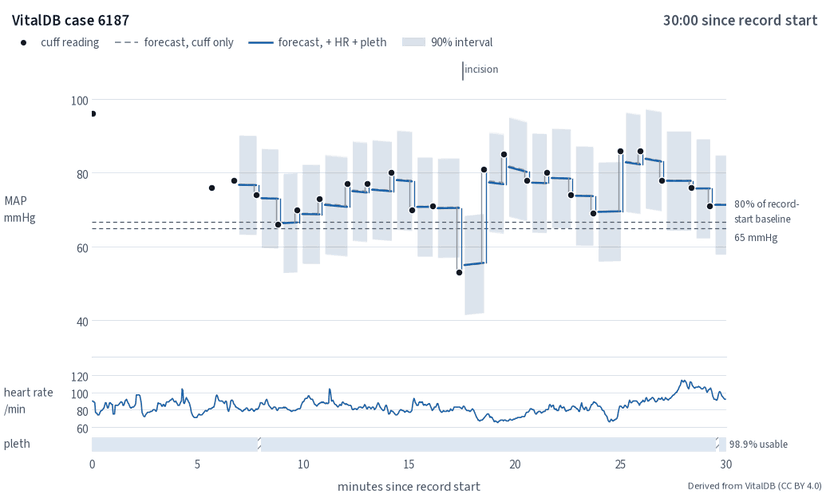
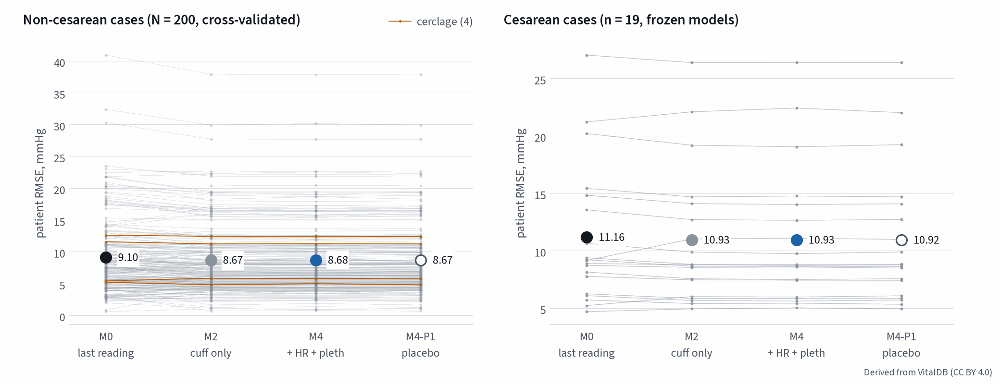

# between-the-cuffs

**After spinal anesthesia, do heart rate and the pulse-oximeter waveform improve the forecast of the next cuff reading (MAP) beyond the cuff readings alone?**

**No.** In 200 non-cesarean spinal cases (cross-validated), heart rate and the pleth waveform did not meet the pre-specified rule (−0.1%, from 8.67 to 8.68 mmHg; rule: at least 5%, with the 95% CI excluding zero). Gains larger than 0.2% (0.01 mmHg) are not compatible with these data (approximate 95% CI), for this feature set and a linear model.

In the 19 cesarean cases (external, frozen models): 0.0% (95% CI −0.4% to 0.4%); this is a case series and neither confirms nor refutes the answer above.

[Pre-registered](PREREG.md) on 2026-11-21 (public release 2026-11-22), before any model was fitted · models frozen [2026-11-23](https://github.com/starriet9/between-the-cuffs/tree/models-frozen) · cesarean cases scored once on [2026-11-23](https://github.com/starriet9/between-the-cuffs/tree/44cfb63); dates in KST (UTC+9) · placebo control · open data ([VitalDB](https://vitaldb.net/))

[20-s replay](#replay) · [All 19 cesarean cases](https://starriet9.github.io/between-the-cuffs/#cases) · [Full report](REPORT.md) · [How to read these numbers](REPORT.md#how-to-read-these-numbers) · Reproduce: `uv run --locked --group encoder scripts/reproduce.py`

In 200 non-cesarean spinal cases (cross-validated), heart rate and pleth waveform features did not meet the pre-specified rule for lowering next-reading MAP forecast error beyond a cuff-only third-order model (−0.1%, Δ 0.01 mmHg, 95% CI −0.01 to 0.03; rule: at least 5%, with the 95% CI excluding zero). Gains larger than 0.2% (0.01 mmHg) are not compatible with these data (approximate 95% CI, see §6.2 of SPEC), for this feature set and a linear model.

In the 19 cesarean cases (external, frozen models): 0.0% (Δ 0.00 mmHg, 95% CI −0.04 to 0.04), waveform coverage 100.0%; this is a case series and neither confirms nor refutes the first sentence.

In the 30 fast-cycling development cases (median cuff interval \< 90 s): 0.3% (Δ −0.03 mmHg, 95% CI −0.07 to 0.01); one extra cuff reading's value recovered by the added signals: −0.9% (95% CI −2.2% to −0.1%) (not distinguishable from placebo inputs).

## What this means (written before the result)

A null is harder to attribute to the drug proxy, but opposite heart-rate responses to the two vasopressors could also cancel in a linear model. It bounds only this feature set under a linear model; the gradient-boosting check in `REPORT.md` asks the same question without the linear form.

Either way, only data with time-stamped vasopressor doses can settle the question.

## Next experiment

On a platform with time-stamped vasopressor doses and 1-minute cuffs, test the increment of the pleth waveform over an ARX model that includes the drug term: retrospectively first, then scored silently and prospectively, with the same placebo and echo controls. The drug-proxy confound is named in advance: heart rate falls after phenylephrine and rises after ephedrine, so only with the doses in the model can a gain from heart rate or the pleth be told apart from the drug. Two measurements this dataset lacks would separate more: the monitor's perfusion-index numeric (does pleth amplitude follow vascular tone, or only the display scaling?) and a recorded probe site (does pulse arrival time cross the blocked territory, and does inflation of a cuff on the same arm shape the pleth?). These are proposals, not results.

## Replay

VitalDB case 6187, chosen by a pre-set rule (median case, [PREREG.md](PREREG.md) §8). The first and last frames show the complete record.

## Error by model

| Model | Non-cesarean, N = 200: mean RMSE (95% CI), mmHg | Cesarean, n = 19: mean RMSE (95% CI), mmHg |
|---|---:|---:|
| M00 · running mean of the readings so far | 12.57 (11.52 to 13.66) | 13.19 (10.85 to 16.08) |
| M0 · last reading (persistence) | 9.10 (8.34 to 9.92) | 11.16 (8.70 to 13.95) |
| M2 · cuff only, third order | 8.67 (7.95 to 9.44) | 10.93 (8.49 to 13.69) |
| M3 · M2 + heart rate | 8.68 (7.96 to 9.44) | 10.93 (8.49 to 13.69) |
| M4 · M3 + pleth waveform | 8.68 (7.97 to 9.44) | 10.93 (8.48 to 13.72) |
| M4-P1 · M4 on another patient's signals (placebo) | 8.67 (7.95 to 9.44) | 10.92 (8.49 to 13.69) |
| Waveform coverage · share of forecasts with waveform features | 97.5% | 100.0% |

New-onset readings below 80% of the record-start baseline flagged one reading ahead (secondary, descriptive): Non-cesarean: M2 6/128 (0.10 false alarms per 30 min), M3 6/128 (0.09 false alarms per 30 min), M4 7/128 (0.12 false alarms per 30 min), M4-P1 6/128 (0.10 false alarms per 30 min); Cesarean: M2 3/28 (0.21 false alarms per 30 min), M3 3/28 (0.21 false alarms per 30 min), M4 2/28 (0.11 false alarms per 30 min), M4-P1 3/28 (0.21 false alarms per 30 min).

Each grey line is one patient; the orange lines are the 4 analysed cerclage cases among the non-cesarean cases. The larger marks are the patient-level means.

## What this does not show

- The analysis is retrospective, with 21 cesarean cases (20 analysable, 1 of them not analysed because a neuromuscular blocker was recorded), 19 flagged emergency.
- The spinal injection time is unknown, and the baseline is a record-start value, not pre-spinal.
- Bolus times are absent and the models have no drug input, so a heart-rate gain may reflect unrecorded drugs.
- This is a research prototype, not medical advice.

The full list is in [REPORT.md](REPORT.md).

## Author's note

The echo and placebo controls ask of a time-series model the question I study in imaging: does the model use the evidence in front of it (here, the pleth), or infer from context (the cuff history)?

## Credit

Derived from VitalDB ([CC BY 4.0](https://creativecommons.org/licenses/by/4.0/)). Changes: cuff readings extracted by change detection; signals resampled, filtered and segmented; features computed; plots and summary statistics derived. No attempt was made to identify any person.

Data: VitalDB, Lee HC, et al. Sci Data 2022;9:279, [doi:10.1038/s41597-022-01411-5](https://doi.org/10.1038/s41597-022-01411-5). No VitalDB data are redistributed here; the code downloads them from the public API at run time.

Author: Jun-Young Cha ([github.com/starriet9](https://github.com/starriet9)).
