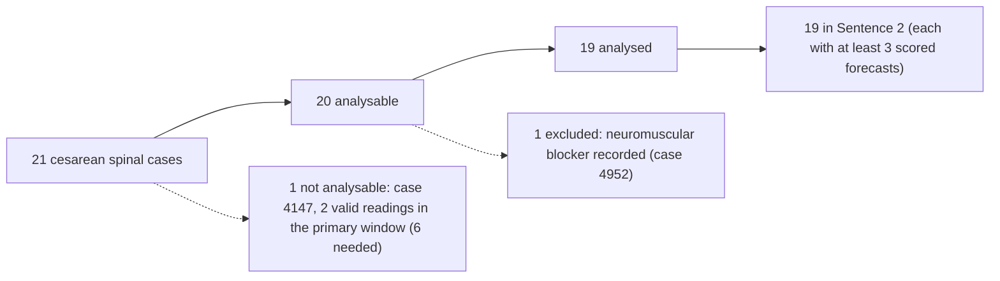
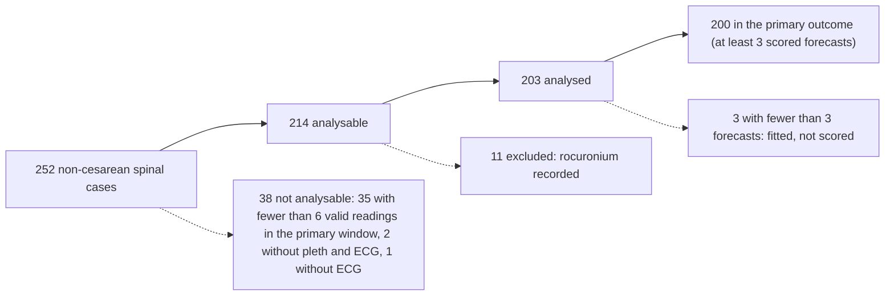

# between-the-cuffs: report

This file gives the confirmatory result on the non-cesarean cases, how to read it, the frozen models, the one scoring of the cesarean cases, the secondary analyses and the gradient-boosting check, the exploratory encoder check, the implementation choices, and every deviation from the registration (`PREREG.md` and `SPEC.md`, version 1.5).

Two cohorts are used. **S-dev** is the development cohort: the non-cesarean spinal cases, on which every model is fitted and cross-validated. The answer to the question comes from S-dev. **S-ob** is the cesarean cohort: an external case series, scored once with the frozen models.

**Contents.** [How to read these numbers](#how-to-read-these-numbers) · [What the forecasts are scored on](#what-the-forecasts-are-scored-on) · [Reading the result](#reading-the-result) · [Confirmatory result, S-dev](#confirmatory-result-s-dev) · [Cesarean cases (S-ob)](#cesarean-cases-s-ob) · [Secondary analyses (S-dev)](#secondary-analyses-s-dev) · [Gradient-boosting check](#gradient-boosting-check-specmd-68) · [Limits](#limits) · [Deviations](#deviations) · [Reproducibility](#reproducibility-specmd-10) · [Exploratory encoder check](#exploratory-pretrained-encoder-check-encoder_planmd)

**Status of this version** (written after the cesarean scoring and the secondary analyses; times in KST unless marked UTC):

| Step (`SPEC.md` §9) | Status |
|---|---|
| 1. Registration, version 1.5 | done; commit 2026-11-21, public release 2026-11-22 (tag `prereg-v1.5`) |
| 2. Pipeline built and checked on S-dev | done; see "Implementation choices" |
| 3. Feature code frozen | done; commit 2026-11-21, public release 2026-11-22 (tag `feature-freeze`) |
| 4–5. Confirmatory S-dev run | done, 2026-11-22; result below |
| 6. Models frozen | done; commit `ea852f0`, 2026-11-23 04:29; public release 2026-11-22 19:37:25 UTC (tag `models-frozen`) |
| 7. S-ob scored once | done, 2026-11-23 04:38 (2026-11-22 19:38:48 UTC), at tag `models-frozen`; see "Cesarean cases (S-ob)" |
| 8. Remaining analyses and replays | S-ob analyses after the frozen scoring: done, 2026-11-23 04:39, at tag `models-frozen`. S-dev secondary analyses and gradient-boosting check: done, 2026-11-23 04:50, at tag `feature-freeze` (see "Secondary analyses (S-dev)"). Per-case series for the replays and the case browser: written 2026-11-23 04:39, at tag `models-frozen` (log event `site_cases_written`) |
| Exploratory encoder check (`SPEC.md` §6.8) | done 2026-11-23: S-dev run at `d66ad63`, cesarean appendix run once at `dda1d6d`; rule not met; see "Exploratory pretrained-encoder check" |

## Why it matters

*Explanatory, not pre-specified. This paragraph is in `README.md` at tag `models-frozen`. It moved here because `SPEC.md` §8.1 limits the README to its blocks. The registered wording is in `SPEC.md` §0.*

After a spinal, the cuff reads blood pressure every 1–5 minutes, and pressure can fall between two readings. The pulse oximeter and the ECG record continuously and are already on every patient, so a gain from them would need no new sensor. This test asks how much they improve a forecast of the next cuff reading that already uses the past cuff readings.

## Registration

| Version | Commit | Date | `PREREG.md` SHA-256 | `SPEC.md` SHA-256 |
|---|---|---|---|---|
| 1.4 | `fca645e` | 2026-11-19 | `7fc6684469a8275eae37f2f3e5178ee267a00d13e040962030e1322c79a00c60` | `91ec51922d62402076bb1d219405b2bb5820918ee3a41fb0f805e18b6309bb29` |
| 1.5 | `59939b7` | 2026-11-21 | `1a866d6a991bbacc4827da3b3bdaa47b4c483e76a41a523530525aedc5eee7d8` | `ccfbb764f836f55a68ac6cc0f352722619d66b9ff28154b1012526d688a78867` |

Version 1.5 replaced version 1.4 before any model was fitted; `PREREG.md` §11 lists the changes. This is a self-registration by git commit. The dates in the table are commit dates, which the author sets. The `published_at` time of each GitHub release is set by GitHub's server; it can be read on the repository's [Releases page](https://github.com/starriet9/between-the-cuffs/releases) or from the GitHub releases API, in UTC. Other dates in this repository are Korea Standard Time (KST, UTC+9) unless marked. The version 1.5 text was first committed locally on 2026-11-20 and amended on 2026-11-21, before its first push, to add the neuromuscular-blocker rule and the reviewer-guide clause; only the pushed commit is the registration. No archive snapshot was made.

| Tag | Commit | Commit date (set by the author, KST) | Release published (set by GitHub, UTC) |
|---|---|---|---|
| `prereg-v1.5` | `59939b7` | 2026-11-21 02:58 | 2026-11-22 11:50:39 |
| `feature-freeze` | `0669d0c` | 2026-11-21 02:58 | 2026-11-22 11:53:08 |
| `models-frozen` | `ea852f0` | 2026-11-23 04:29 | 2026-11-22 19:37:25 |

**What these records can and cannot show.** GitHub's records show that the registration and the feature tag were public before any result file was: the result files are first published with tag `models-frozen`. They also show that the `models-frozen` release was public before the cesarean scoring started (19:38:48 UTC in `results/sob/frozen_scoring_log.jsonl`; see "Scoring record"). They cannot show when a model was first fitted. The author's record is this: the confirmatory run (`SPEC.md` §9 step 5) was made on 2026-11-22 at 21:55 KST (12:55 UTC), about an hour after both releases; and no model was fitted to real data before that run, because earlier runs of the model code used synthetic data only (`btc/models/synthetic.py`, `tests/`). The result files hold no timestamps, so the run time comes from local file times and cannot be checked from the repository.

`PREREG.md` and `SPEC.md` are unchanged since the registration commit (`git diff prereg-v1.5 models-frozen -- PREREG.md SPEC.md` is empty, and `git log prereg-v1.5.. -- PREREG.md SPEC.md` lists no later commit); their SHA-256 values are those of the 1.5 row. Statements in them such as "No model has been fitted to any case so far" (`SPEC.md` §9) describe the time of registration.

## Confirmatory result, S-dev

**Run.** `scripts/run_confirmatory.py` at tag `feature-freeze` (commit `0669d0c`). `meta` in `summary.json` and in `MANIFEST.json` records the commit, the tag at HEAD and that no tracked file was modified; every CSV and Markdown file carries the commit in its first line. Inputs: the derived S-dev tables whose SHA-256 values are in `results/sdev/MANIFEST.json` (`meta.inputs_sha256`). Outputs: `results/sdev/confirmatory/` (file map in `results/README.md`). The run chose the M2 structure and then fitted M2, M3, M4, the placebo models M3-P1 and M4-P1, and the yardstick models L, LH, T, LH-P1, T-P1 and U, each in 5 outer folds with penalties chosen by inner cross-validation (`SPEC.md` §4.1, §4.5). It did not run the secondary analyses; they were run later at the same tag (see "Secondary analyses (S-dev)").

**Headline row: 6** (M4 vs M2 does not meet the rule; `summary.json`, `decision`). Placebo validity was not evaluated, because it is checked only for a contrast that meets the rule (`PREREG.md` §6). Unrounded, G = 0.163% and g = 0.0142 mmHg (`summary.json`, `decision`).

The registered sentences, as written by the runs (`results/sdev/confirmatory/headline.md`; Sentence 2 and the cesarean line: `results/sob/frozen_scoring/headline.md`):

> **Answer line.** No. In 200 non-cesarean spinal cases (cross-validated), heart rate and the pleth waveform did not meet the pre-specified rule (−0.1%, from 8.67 to 8.68 mmHg; rule: at least 5%, with the 95% CI excluding zero). Gains larger than 0.2% (0.01 mmHg) are not compatible with these data (approximate 95% CI), for this feature set and a linear model.
>
> **Cesarean line.** In the 19 cesarean cases (external, frozen models): 0.0% (95% CI −0.4% to 0.4%); this is a case series and neither confirms nor refutes the answer above.
>
> **Sentence 1.** In 200 non-cesarean spinal cases (cross-validated), heart rate and pleth waveform features did not meet the pre-specified rule for lowering next-reading MAP forecast error beyond a cuff-only third-order model (−0.1%, Δ 0.01 mmHg, 95% CI −0.01 to 0.03; rule: at least 5%, with the 95% CI excluding zero). Gains larger than 0.2% (0.01 mmHg) are not compatible with these data (approximate 95% CI, see §6.2 of SPEC), for this feature set and a linear model.
>
> **Sentence 2.** In the 19 cesarean cases (external, frozen models): 0.0% (Δ 0.00 mmHg, 95% CI −0.04 to 0.04), waveform coverage 100.0%; this is a case series and neither confirms nor refutes the first sentence.
>
> **Sentence 3.** In the 30 fast-cycling development cases (median cuff interval < 90 s): 0.3% (Δ −0.03 mmHg, 95% CI −0.07 to 0.01); one extra cuff reading's value recovered by the added signals: −0.9% (95% CI −2.2% to −0.1%) (not distinguishable from placebo inputs).

Terms used below. MAP is mean arterial pressure. The pleth is the pulse-oximeter waveform. RMSE is the root-mean-square forecast error of one patient, and "mean RMSE" is its mean over patients. "Cross-validated" means that each patient's forecasts come from models fitted without that patient. A penalty is the strength of the ridge shrinkage on one block of coefficients; the three blocks are cuff, heart rate and waveform. "Dropped" means that inner cross-validation left a block out.

### How to read these numbers

*(explanatory, not pre-specified) These five points are in `README.md` at tag `models-frozen`, written after the S-dev result was known and before the cesarean cases were scored. They moved here because `SPEC.md` §8.1 limits the README to its blocks. They describe the S-dev result.*

- MAP is mean arterial pressure, and the pleth is the pulse-oximeter waveform. Cross-validated means that each patient's forecasts come from models fitted without that patient.
- The error is each patient's root-mean-square forecast error (RMSE), averaged over patients. Δ is that error with heart rate and waveform features minus the error without them. The positive Δ and the negative percentage say the same thing: with the added signals the error was slightly higher.
- 203 cases were analysed. 200 of them have the 3 forecasts needed for an RMSE and are scored.
- The interval is narrow because cross-validation shrank the added coefficients heavily, so the two models gave nearly the same forecasts. The bound describes this fitted procedure and this feature set. It does not measure how much information the signals hold.
- The last number of the third sentence comes from a harder test, in which the latest cuff reading is hidden from the model. The signals recovered none of that reading's value there.

### What the forecasts are scored on

*(explanatory, not pre-specified; added on 2026-11-23 after an external review of the posted results)*

- **Timing.** Each forecast is issued at a cuff reading and scored at the time the next reading was actually taken. That interval, h, is an input of every model (`SPEC.md` §3) and is the one input not known when the forecast is issued, so these are forecasts conditional on the next reading's time, not real-time forecasts. With h replaced by the median of the patient's previous intervals ("Refitted variants and the feature-group ablation", S-dev), M4 vs M2 is +0.028 mmHg (95% CI 0.004 to 0.056; relative reduction −0.32%): the added signals did not help there either. Prospective scoring is part of the next experiment (`README.md`).
- **The cuff-only structure.** The M2 structure was chosen among four on the S-dev outer-fold predictions (`SPEC.md` §4.1; "M2 structure") and is shared by M3, M4 and their placebo versions. The choice can make the absolute errors slightly optimistic; it enters both sides of the M4 vs M2 contrast [judgment]. Choosing the structure inside each outer training fold would remove that optimism.
- **What the interval covers.** The subject bootstrap treats the fitted fold models as fixed (`SPEC.md` §6.2). Across ten fold seeds, Δ ranged from −0.004 to 0.026 mmHg ("Fold-seed sensitivity"), about the width of the CI, so the bound describes this fitted procedure at these folds, not the information the signals hold.

### Reading the result

*Post hoc and explanatory, not pre-specified (`PREREG.md` §10). Written after the S-dev result was known and before the cesarean cases were scored. The last sentence of item 4 was updated after the secondary analyses were run.*

This section changes no registered sentence. Every number in it is in `results/sdev/confirmatory/` or `results/frozen/` (item 4, last sentence: `results/sdev/secondary/`), or follows from those files by the arithmetic stated.

1. **Signs.** Δ is the model's patient-level mean RMSE minus the comparator's, so a positive Δ means the added signals did worse. The relative reduction is 1 minus the ratio of the two means, so a negative percentage means the error rose. For M4 vs M2, Δ = +0.009 mmHg and the relative reduction is −0.11%.
2. **What was compared.** The primary contrast compares two fitted procedures: M2 (cuff only) and M4 (cuff, heart rate and waveform), each with its penalties chosen by inner cross-validation as registered. Δ and its interval describe the difference in their cross-validated error. They do not measure how much information about the next reading the signals contain.
3. **Heavy shrinkage, so a narrow interval.** Inner cross-validation kept both added blocks in all 5 outer folds but chose strong penalties: 3.16 to 31.6 for the heart-rate block and 3.16 to 1000 for the waveform block, against 1 for the cuff block in every fold (`penalties.csv`). Under the objective of `SPEC.md` §4.5, a penalty λ multiplies the coefficient of an isolated standardised column by 1/(1 + λ): 1 halves it, 10 leaves 9% of it and 1000 leaves 0.1%. M4's forecasts therefore stay close to M2's. Per patient, M4's RMSE was lower than M2's in 102 of the 200 patients and higher in 98; the difference has a median absolute value of 0.08 mmHg, a largest absolute value of 0.94 mmHg and an SD of 0.18 mmHg, while both models' mean RMSE is about 8.7 mmHg (`per_patient_primary.csv`). Two nearly identical sets of forecasts have nearly identical errors, so their paired difference has a narrow interval. A normal approximation from these 200 differences gives almost the same interval as the bootstrap (−0.015 to 0.033 mmHg). Had every fold dropped both blocks, M4 would equal M2, Δ would be exactly zero, and the bound sentence would be omitted (G ≤ 0; `SPEC.md` §6.3).
4. **What the bound sentence covers.** "Gains larger than 0.2% (0.01 mmHg) are not compatible with these data" refers to this procedure in this cohort: ridge regression on these 11 features (3 heart-rate features, and 4 waveform features in 2 forms each, every one also multiplied by the horizon; `SPEC.md` §4.2–§4.5), with penalties chosen as registered. It is not a bound for other features, other models, other monitors or other patients. The two numbers in the sentence come from two intervals: G = 0.163% is the upper 95% limit of the relative reduction, and g = 0.0142 mmHg is minus the lower 95% limit of Δ. The registered formats give percentages one decimal and mmHg two, which is why 0.2% and 0.01 mmHg do not match each other exactly (0.163% of 8.67 mmHg is 0.014 mmHg). The interval also treats the five fold models as fixed (`SPEC.md` §6.2). Under ten further fold seeds, Δ ranged from −0.004 to 0.026 mmHg (`fold_seed_sensitivity.csv`; "Secondary analyses (S-dev)").
5. **Less shrinkage was available, and it did worse.** The penalty grid starts at 0.001, which is almost no penalty, and ends at 1000 (13 values; `SPEC.md` §4.1). Each added block could also be dropped. For the refit on all analysed S-dev cases, `results/frozen/penalty_path.csv` gives the cross-validation criterion of every candidate ("Frozen models" below). With a penalty of 0.001 the added blocks raised the criterion by 0.12 mmHg (heart rate) and 0.17 mmHg (waveform) against leaving the block out. At the chosen penalties they lowered it by 0.0007 and 0.003 mmHg. A waveform block built from another patient's signals lowered it by about as much (0.003 mmHg), and in the yardstick models the donor blocks lowered it more than the patients' own. At this size, whether a block is "kept" or "dropped" says little about whether it carries signal.
6. **Positive controls.** The same scoring detects an informative input. One extra cuff reading lowers the yardstick error by D = 1.94 mmHg (95% CI 1.46 to 2.45), from 10.45 mmHg without it (L) to 8.51 mmHg with it (U), in 122 patients. M2 lowers error by 31.0% (95% CI 26.0% to 35.7%) against the running mean (M00) and by 4.7% (95% CI 3.0% to 6.3%) against repeating the last reading (M0). On synthetic data with a strong planted waveform or heart-rate signal, the pipeline finds it, attributes it to its block and does not find it in the placebo version (`tests/test_models_end_to_end.py`). These controls check the code path. They do not show how weak a waveform signal the pipeline could detect.
7. **Between the cuffs.** The primary forecast is issued when a new cuff reading arrives. That is when the cuff value is newest and a continuous signal has the least to add. The withheld-cuff yardstick (`SPEC.md` §3) asks the harder question: with the latest reading's values hidden, how much of that reading's worth do the signals recover? N = −0.01 mmHg (95% CI −0.04 to 0.02) against D = 1.94 mmHg, in 122 patients and 909 triples, so F = −0.5% (95% CI −2.0% to 1.0%). In the 30 fast-cycling cases N = −0.025 mmHg (95% CI −0.048 to −0.002): the forecast with the signals (T) was slightly worse than the one without them (L), which is why F is negative in Sentence 3. A negative F does not mean that the signals took value away from the cuff.
8. **The cuff-only model is modest.** M2's mean RMSE is 8.67 mmHg, 4.7% below that of repeating the last reading (9.10 mmHg). Its mean per-patient R² is −0.64 and its mean FIT −18.8%, in the 138 patients with at least 5 forecasts and a non-zero SST. The mean is pulled down by a few patients: the median R² is −0.28, and R² is below zero in 90 of the 138 (`per_patient_primary.csv`). A negative R² means that the model did worse than that patient's own in-window mean of the observed readings, a reference that is not available in real time (`SPEC.md` §6.1). Patients have few forecasts (a median of 6 among the 200 who enter), so these per-patient values are noisy.
9. **Weighting.** With every forecast weighted equally (pooled RMSE over the 1,416 forecasts of the 200 patients), M4 scores 10.104 mmHg and M2 10.117 mmHg: M4 is 0.12% lower. This is the opposite sign to the primary metric, in which M4 is 0.11% higher. No interval was computed for the pooled difference, and both differences are far below the 5% margin. The primary metric is per patient (`SPEC.md` §6.1, following the per-patient metrics of the earlier work cited in `SPEC.md` §1), so every patient counts once. A pooled RMSE gives more weight to patients with more forecasts: the 30 fast-cycling patients are 15% of the patients but hold 414 of the 1,416 forecasts (29%).
10. **Placebo.** M4 on another patient's signals (M4-P1) had a mean RMSE of 8.675 mmHg, and M4 on the patient's own signals 8.681 mmHg (M4 − M4-P1 = 0.007 mmHg, 95% CI −0.018 to 0.032). Inner cross-validation kept the heart-rate block in all 5 folds with real signals and dropped it in 4 of 5 with donor signals, yet M3 was not better than M2 in the outer folds (Δ 0.008 mmHg, 95% CI −0.006 to 0.024).

### Who enters

- **Primary outcome.** The 203 analysed cases ("Cohort flow, S-dev" below) have 1,421 primary next-reading forecasts; 1,386 of them (97.5%) have waveform features. Three cases have fewer than 3 forecasts: 3540 (2), 4896 (2) and 5707 (1). The registered minimum for RMSE is 3 scored forecasts per patient (`SPEC.md` §6.1, `PREREG.md` §6), so they do not enter. They stay in the folds (`folds.csv`) and their forecasts are used in fitting; only the scoring leaves them out. N = 200 patients with 1,416 forecasts, a median of 6 per patient (interquartile range 4 to 9, range 3 to 24). Each analysed case belongs to a different subject (`folds.csv`), so the subject bootstrap resamples 200 subjects.
- **Fast-cycling cases** (median cuff interval < 90 s, `SPEC.md` §6.7): 30 of the analysed cases. All 30 have at least 3 forecasts (K = 30; 414 forecasts) and at least 3 scored triples (365 triples), so F in Sentence 3 uses all 30.
- **Withheld-cuff yardstick, all S-dev.** 152 cases have at least one triple (952 triples); 122 of them have at least 3 and enter, with 909 triples. A triple needs three consecutive valid readings within 400 s (`SPEC.md` §3), and S-dev cuffs cycle slowly (median interval 154 s in the analysable cases; `SPEC.md` §3), so fewer cases enter here than in the primary outcome.

### Error by model

Patient-level mean ± SD over the 200 entering patients, in mmHg, with the 95% CI of the mean from the subject bootstrap (2,000 resamples, seed 20261118). R² and FIT use the 138 patients with at least 5 forecasts and a non-zero SST (65 of the 203 do not qualify). Mean signed error is forecast minus observed. Pooled RMSE weights every forecast equally (1,416 forecasts of the 200 entering patients). Source: `model_summary.csv`. Tables in this file give more decimals than the registered sentences; the files give full precision.

| Model | RMSE, mean ± SD (95% CI) | MAE, mean ± SD | Mean signed error, mean ± SD | R², mean ± SD | FIT %, mean ± SD | Pooled RMSE (95% CI) |
|---|---|---|---|---|---|---|
| M00 | 12.57 ± 8.13 (11.52 to 13.66) | 11.15 ± 7.64 | 7.89 ± 8.65 | −2.69 ± 4.59 | −71.3 ± 87.2 | 14.729 (13.21 to 16.37) |
| M0 | 9.10 ± 5.97 (8.34 to 9.92) | 7.22 ± 4.63 | 1.87 ± 3.09 | −0.73 ± 1.33 | −24.6 ± 42.7 | 10.654 (9.69 to 11.65) |
| M1 | 12.56 ± 7.58 (11.59 to 13.63) | 10.03 ± 5.91 | −0.59 ± 3.55 | −2.90 ± 4.81 | −79.4 ± 82.8 | 14.321 (13.18 to 15.52) |
| M2 | 8.67 ± 5.57 (7.95 to 9.44) | 6.94 ± 4.43 | 0.18 ± 3.90 | −0.64 ± 1.92 | −18.8 ± 47.6 | 10.117 (9.20 to 11.06) |
| M3 | 8.68 ± 5.56 (7.96 to 9.44) | 6.95 ± 4.42 | 0.18 ± 3.92 | −0.64 ± 1.87 | −18.9 ± 47.2 | 10.119 (9.20 to 11.06) |
| M4 | 8.68 ± 5.55 (7.97 to 9.44) | 6.95 ± 4.42 | 0.15 ± 3.93 | −0.64 ± 1.91 | −19.2 ± 47.5 | 10.104 (9.20 to 11.05) |
| M3-P1 | 8.67 ± 5.57 (7.95 to 9.44) | 6.95 ± 4.43 | 0.18 ± 3.90 | −0.64 ± 1.92 | −18.9 ± 47.6 | 10.117 (9.20 to 11.06) |
| M4-P1 | 8.67 ± 5.57 (7.95 to 9.44) | 6.95 ± 4.43 | 0.18 ± 3.90 | −0.64 ± 1.92 | −18.9 ± 47.6 | 10.118 (9.20 to 11.06) |

M00 is the running mean of the readings so far; M0 repeats the last reading; M1 extends the trend of the last three readings; M2 is the cuff-only third-order ridge model; M3 adds heart rate; M4 adds the waveform features; P1 marks a model refitted on another patient's signals (`SPEC.md` §4.1, §6.6). Over all 1,421 forecasts of the 203 analysed cases, the pooled RMSE is 10.103 mmHg for M2, 10.105 for M3 and 10.091 for M4 (`pooled_rmse` in the same file).

### Contrasts

200 patients in every row. Δ = mean RMSE of the model minus that of the comparator; relative reduction = 1 − (model / comparator). Source: `contrasts.csv`. No contrast with M3 or M4 as the model meets the rule.

| Model | Comparator | Mean RMSE, model / comparator (mmHg) | Δ (95% CI), mmHg | Relative reduction (95% CI) |
|---|---|---|---|---|
| M4 | M2 | 8.681 / 8.672 | 0.009 (−0.014 to 0.033) | −0.11% (−0.38% to 0.16%) |
| M3 | M2 | 8.680 / 8.672 | 0.008 (−0.006 to 0.024) | −0.09% (−0.28% to 0.07%) |
| M4 | M3 | 8.681 / 8.680 | 0.001 (−0.017 to 0.019) | −0.01% (−0.22% to 0.20%) |
| M4-P1 | M2 | 8.675 / 8.672 | 0.002 (−0.003 to 0.008) | −0.03% (−0.09% to 0.03%) |
| M3-P1 | M2 | 8.675 / 8.672 | 0.002 (−0.002 to 0.007) | −0.03% (−0.08% to 0.03%) |
| M4 | M4-P1 | 8.681 / 8.675 | 0.007 (−0.018 to 0.032) | −0.08% (−0.36% to 0.20%) |
| M3 | M3-P1 | 8.680 / 8.675 | 0.006 (−0.010 to 0.022) | −0.07% (−0.26% to 0.12%) |
| M2 | M0 | 8.672 / 9.100 | −0.428 (−0.585 to −0.269) | 4.70% (3.04% to 6.26%) |
| M2 | M00 | 8.672 / 12.567 | −3.895 (−4.710 to −3.114) | 30.99% (26.04% to 35.73%) |
| M2 | M1 | 8.672 / 12.564 | −3.892 (−4.440 to −3.391) | 30.98% (28.05% to 34.13%) |

### Fast-cycling cases

The 30 fast-cycling cases (414 forecasts), scored from the same outer-fold predictions; nothing is refitted on the subset (`SPEC.md` §6.7). Source: `contrasts_fast_cycling.csv`.

| Model | Comparator | Mean RMSE, model / comparator (mmHg) | Δ (95% CI), mmHg | Relative reduction (95% CI) |
|---|---|---|---|---|
| M4 | M2 | 8.939 / 8.964 | −0.026 (−0.074 to 0.014) | 0.29% (−0.17% to 0.80%) |
| M3 | M2 | 8.959 / 8.964 | −0.005 (−0.022 to 0.014) | 0.06% (−0.17% to 0.25%) |
| M4 | M3 | 8.939 / 8.959 | −0.021 (−0.067 to 0.017) | 0.23% (−0.19% to 0.76%) |
| M4-P1 | M2 | 8.967 / 8.964 | 0.002 (−0.003 to 0.008) | −0.03% (−0.10% to 0.03%) |
| M3-P1 | M2 | 8.965 / 8.964 | 0.001 (−0.003 to 0.004) | −0.01% (−0.04% to 0.03%) |
| M4 | M4-P1 | 8.939 / 8.967 | −0.028 (−0.076 to 0.013) | 0.31% (−0.15% to 0.83%) |
| M3 | M3-P1 | 8.959 / 8.965 | −0.006 (−0.022 to 0.014) | 0.06% (−0.16% to 0.25%) |
| M2 | M0 | 8.964 / 9.246 | −0.281 (−0.485 to −0.069) | 3.04% (0.79% to 5.31%) |
| M2 | M00 | 8.964 / 12.436 | −3.471 (−5.380 to −1.761) | 27.91% (18.34% to 34.98%) |
| M2 | M1 | 8.964 / 12.379 | −3.415 (−4.214 to −2.614) | 27.59% (21.51% to 33.41%) |

### Withheld-cuff yardstick

The forecasts of reading r+2 (`SPEC.md` §3): L, issued at reading r+1 with that reading's values withheld and no added signals; U, M2 issued at reading r+1; T, L plus the heart-rate and waveform blocks; LH, the intermediate model, L plus the heart-rate block. T-P1 and LH-P1 use donor signals. RMSE values are patient-level means in mmHg. Source: `summary.json` (`yardstick_all`, `yardstick_fast_cycling`).

| | All S-dev | Fast-cycling |
|---|---|---|
| Cases entering (at least 3 triples) / cases with a triple | 122 / 152 | 30 / 30 |
| Triples in entering cases / all triples | 909 / 952 | 365 / 365 |
| RMSE of L / U / T / T-P1 | 10.450 / 8.513 / 10.460 / 10.492 | 11.468 / 8.854 / 11.493 / 11.478 |
| RMSE of LH / LH-P1 | 10.447 / 10.467 | 11.467 / 11.454 |
| D = RMSE L − RMSE U (95% CI) | 1.937 (1.456 to 2.452) | 2.614 (1.484 to 3.929) |
| N = RMSE L − RMSE T (95% CI) | −0.010 (−0.037 to 0.019) | −0.025 (−0.048 to −0.002) |
| F = N / D (95% CI) | −0.5% (−2.0% to 1.0%) | −0.9% (−2.2% to −0.1%) |
| RMSE T − RMSE T-P1 (95% CI) | −0.032 (−0.103 to 0.041) | 0.014 (−0.049 to 0.086) |
| Placebo guard passed | no | no |

F is reported in both, because the 95% CI of D lies above zero (no bootstrap resample had D ≤ 0). A negative F means that T, with the added signals, had a slightly larger error than L, without them. The placebo guard did not pass, because the CI of RMSE T − RMSE T-P1 does not lie below zero; Sentence 3 therefore ends "(not distinguishable from placebo inputs)".

### M2 structure

Chosen on the outer-fold predictions of the patients with at least 3 forecasts (`SPEC.md` §4.1, §4.5). Source: `m2_structure.csv`.

| M2 form | Horizon structure | Patient-level mean RMSE, mmHg | Chosen |
|---|---|---|---|
| (a) level, slope, curvature | one model per h-bin | 8.759 | |
| (a) level, slope, curvature | pooled, with horizon interactions | 8.672 | yes |
| (b) raw-lag AR(3) | one model per h-bin | 8.864 | |
| (b) raw-lag AR(3) | pooled, with horizon interactions | 8.732 | |

The chosen structure is used for M2, M3, M4 and their placebo versions; the yardstick models use the same form, pooled (`SPEC.md` §3).

### Penalties per outer fold

The penalty chosen by inner cross-validation in each outer fold, from the grid 0.001 … 1000 (13 values), or "dropped": the block is left out and the model returns the forecast of the model below it (`SPEC.md` §4.5). Each row is one stage of a chain and gives the penalty of the block that stage adds: M2 and L the cuff block, M3 and LH the heart-rate block, M4 and T the waveform block; U is M2 issued one reading later. Lower blocks keep their penalties. All models use the pooled structure. Source: `penalties.csv` (chain names as in the file).

| Chain | Model | Fold 0 | Fold 1 | Fold 2 | Fold 3 | Fold 4 |
|---|---|---|---|---|---|---|
| `ladder:real/real` | M2 | 1 | 1 | 1 | 1 | 1 |
| `ladder:real/real` | M3 | 10 | 10 | 10 | 31.6 | 3.16 |
| `ladder:real/real` | M4 | 10 | 1000 | 10 | 3.16 | 10 |
| `ladder:p1/p1` | M2 | 1 | 1 | 1 | 1 | 1 |
| `ladder:p1/p1` | M3-P1 | 10 | dropped | dropped | dropped | dropped |
| `ladder:p1/p1` | M4-P1 | dropped | 31.6 | dropped | dropped | 1000 |
| `yard:real` | L | 1 | 0.316 | 1 | 1 | 0.316 |
| `yard:real` | LH | 10 | 10 | 10 | 31.6 | 100 |
| `yard:real` | T | 1000 | 1000 | dropped | 1000 | 10 |
| `yard:p1` | L | 1 | 0.316 | 1 | 1 | 0.316 |
| `yard:p1` | LH-P1 | 10 | dropped | 100 | 1 | dropped |
| `yard:p1` | T-P1 | dropped | 1 | 1 | dropped | 1 |
| `yard:U` | U | 1 | 1 | 3.16 | 1 | 1 |

How often each added block was dropped across the outer folds (`SPEC.md` §6.7): with the patients' own signals, heart rate 0 of 5 and waveform 0 of 5; with donor signals, heart rate 4 of 5 and waveform 3 of 5.

## Frozen models (`SPEC.md` §9 step 6)

Every confirmatory model was refitted on all 203 analysed S-dev cases. Penalties were chosen by cross-validation over the outer folds of the confirmatory run (`SPEC.md` §4.5). The M2 structure was chosen again and came out the same (form (a), pooled). The refit also fits two secondary models that the cesarean scoring uses: T-ia, the inflation-artefact variant of T (with its intermediate model LH-ia), and the 2-reading-ahead M2.

**Tag** `models-frozen`, on commit `ea852f0` (2026-11-23 04:29 KST). Its GitHub release was published at 2026-11-22 19:37:25 UTC. The refit ran on a clean tree at commit `dcd0ddd`, which `results/frozen/FROZEN.json` records in `meta` (`commit`, `state`). The tagged commit comes after that one and adds the refit's outputs and the documents of that version, so the two hashes differ. No code differs between them: `git diff dcd0ddd models-frozen -- btc scripts tests pyproject.toml uv.lock` is empty.

**`results/frozen/FROZEN.json`** (SHA-256 `6ecadc9d7ed2a569857c124beac92243d4ee74cd134bbc012751db6d81c8d47a`) gives the SHA-256 of `models.pkl` (`ad4c8b4702d152dff0f172a24502298be9579b6f61f7ea8caac858c28fd988c1`), the M2 structure, the models of each chain, the S-dev case counts and the Python, NumPy, pandas, scikit-learn and SciPy versions. Its `meta.inputs_sha256` equals that of the confirmatory run (`results/sdev/MANIFEST.json`).

**Coefficients** (`SPEC.md` §6.7): `results/frozen/coefficients.csv` is the coefficient table. It has one row per design column of every frozen model: the block (cuff, hr or waveform), that block's penalty, the standardised coefficient, the scaler mean and SD, and the imputation median. The models can be applied from this file without unpickling `models.pkl` (`tests/test_frozen_guards.py` checks this on synthetic data). In the frozen M4, the standardised coefficients (mmHg of forecast change per SD of a column) are 0.04 to 0.88 in absolute value in the cuff block, at most 0.02 in the heart-rate block and at most 0.07 in the waveform block.

**Penalties of the refit**, beside those of the outer folds ("Penalties per outer fold" above):

| Chain in `FROZEN.json` | Model (block added) | Refit on all 203 cases | Outer folds 0–4 |
|---|---|---|---|
| `main` | M2 (cuff) | 1 | 1, 1, 1, 1, 1 |
| `main` | M3 (heart rate) | 31.6 | 10, 10, 10, 31.6, 3.16 |
| `main` | M4 (waveform) | 10 | 10, 1000, 10, 3.16, 10 |
| `p1` | M3-P1 (heart rate, donor) | dropped | 10, then dropped in 4 |
| `p1` | M4-P1 (waveform, donor) | 10 | dropped, 31.6, dropped, dropped, 1000 |
| `yard_T`, `yard_TP1`, `yard_Tia` | L (cuff) | 0.001 | 1, 0.316, 1, 1, 0.316 |
| `yard_T` | LH (heart rate) | 31.6 | 10, 10, 10, 31.6, 100 |
| `yard_T` | T (waveform) | 1000 | 1000, 1000, dropped, 1000, 10 |
| `yard_TP1` | LH-P1 (heart rate, donor) | 0.1 | 10, dropped, 100, 1, dropped |
| `yard_TP1` | T-P1 (waveform, donor) | 1 | dropped, 1, 1, dropped, 1 |
| `yard_U` | U (cuff) | 1 | 1, 1, 3.16, 1, 1 |
| `yard_Tia` | LH-ia (heart rate) | 0.00316 | not in the confirmatory run |
| `yard_Tia` | T-ia (waveform) | dropped | not in the confirmatory run |
| `m2_two_ahead` | M2, 2 readings ahead (cuff) | 0.001 | not in the confirmatory run |

**Penalty path** (post hoc; a by-product of the registered selection, not a pre-specified output): `results/frozen/penalty_path.csv` gives, for every chain and stage of the refit, the cross-validation criterion of every candidate penalty and of dropping the block, and the one chosen. The criterion is the patient-level mean RMSE on the validation folds, in mmHg. It counts every case with a validation forecast, with no minimum count (`SPEC.md` §4.5), so it is not the same number as the 8.67 mmHg of the primary outcome. For the main chain, where the cuff-only criterion is 8.6040:

| Block | Chosen penalty | Criterion at the chosen penalty | Criterion at 0.001 | Criterion with the block dropped |
|---|---|---|---|---|
| heart rate (M3) | 31.6 | 8.6033 | 8.7266 | 8.6040 |
| waveform (M4) | 10 | 8.6002 | 8.7694 | 8.6033 |

Three things to note in this file:

- **The gains at the chosen penalties are very small**: 0.0007 mmHg for the heart-rate block and 0.0031 mmHg for the waveform block.
- **Donor signals gave gains of the same size or larger.** In the placebo chain the donor heart-rate block was dropped, and the donor waveform block lowered the criterion by 0.0028 mmHg. In the yardstick chains the donor blocks lowered it by 0.033 mmHg (heart rate) and 0.013 mmHg (waveform), against 0.0004 and 0.0071 mmHg for the patients' own signals. Criterion differences of this size do not separate real from placebo inputs, which agrees with the outer-fold result.
- **Two cuff-only models sit at the lower edge of the grid.** The yardstick model L and the 2-reading-ahead M2 took the smallest penalty, 0.001, where the outer folds chose 0.316 to 1 for L. LH, T, their donor versions and the inflation-artefact versions keep L's cuff penalty. The criterion is nearly flat there (L: 9.748 at 0.316 and 9.730 at 0.001), and 0.001 is close to no penalty, so a wider grid would not give a materially different model. Still, the frozen L is less shrunk than the L models behind the S-dev yardstick numbers above. These models are used only for the cesarean yardstick, which is descriptive.

**Dropped blocks.** The refit dropped the donor heart-rate block (M3-P1) and the waveform block of T-ia. The frozen M3-P1 therefore equals the frozen M2, and the frozen T-ia equals LH-ia. In the cesarean cases the contrast M3-P1 vs M2 is therefore exactly zero by construction (`results/sob/frozen_scoring/contrasts.csv`), and T-ia has the RMSE of LH-ia.

**Unchanged code.** The feature code and the model core are unchanged from tag `feature-freeze` to tag `models-frozen`: `git diff feature-freeze models-frozen` is empty for `btc/beats.py`, `waveform.py`, `hr.py`, `cuff.py`, `pqi.py`, `rpeaks.py`, `instances.py`, `io.py`, `constants.py`, `paths.py`, `provenance.py`, `__init__.py`, `scripts/build_instances.py`, `build_windows.py`, `build_features_wf.py`, `scripts/download.py`, `scripts/select_rpeak_detector.py`, `scripts/pleth_coverage.py`, and for `btc/models/ridge.py`, `design.py`, `data.py`, `folds.py`, `analyses.py`, `bootstrap.py`, `metrics.py`, `headline.py`, `constants.py` and `gbm.py`. The same command with `--stat` lists what did change: the freeze and scoring scripts with their checks, the code that writes the result tables, the site code and the tests.

## Cesarean cases (S-ob)

The frozen models were scored once on the cesarean cases (`SPEC.md` §9 step 7). This is an external case series: it cannot confirm or refute the answer, and it cannot change Sentences 1 and 3 (`SPEC.md` §6.3). Outputs: `results/sob/frozen_scoring/` (file map in `results/README.md`). Data and signal quality of both cohorts are in "Data and signal quality, both cohorts" below.

### Scoring record

- **One run, at the tag.** `scripts/run_frozen_scoring.py score --frozen-tag models-frozen` ran once, at commit `ea852f0`, which carries tag `models-frozen`, from a clean tree. The script refuses to start unless HEAD carries the tag, no file is modified or untracked outside `results/`, and `results/frozen/FROZEN.json` is the file committed at HEAD (`score_problems`). It refuses a second run once `STATE.json` records a completed one.
- **`results/sob/frozen_scoring/STATE.json`**: `status` "completed", `commit` `ea852f0…`, `rerun_after_crash` false.
- **`results/sob/frozen_scoring_log.jsonl`** holds four events, all at commit `ea852f0` (UTC, 2026-11-22): `started` 19:38:48, `completed` 19:38:48, `after_frozen_scoring_written` 19:39:02 and `site_cases_written` 19:39:04. There is no `refused`, `crashed` or `rerun_after_crash` event.
- **`meta` of `frozen_scoring/MANIFEST.json`** (and of `summary.json`): `commit` `ea852f0…`, `describe` "models-frozen", `state` "clean", `status` [], `tags_at_head` ["models-frozen"], `frozen_models_sha256` equal to `models_sha256` in `results/frozen/FROZEN.json`, and the SHA-256 of the five S-ob input tables (`inputs_sha256`).
- **The tag was public before the scoring.** GitHub records the `models-frozen` release as published at 2026-11-22 19:37:25 UTC. The cesarean case files were first requested from VitalDB at 19:38:09 UTC, 44 s later, and the scoring started at 19:38:48 UTC. The request time comes from the local request log, which the download script writes and which is not committed (author's record); the scoring times are in the committed log. The download, the recount under the final cuff rule and the feature build belong to the frozen scoring (`SPEC.md` §9: "That scoring includes the recount").
- **The sensitivity analysis ran in the same process**, before any primary output was written (`score_sob` in `btc/models/pipeline.py`): the frozen models scored on all analysable cases, including the one with a neuromuscular blocker recorded (below).
- **The later S-ob steps ran at the same commit.** The analyses after the frozen scoring (`after`) and the per-case series of the case browser and replays (`series`) ran at `ea852f0` and were logged 14 s and 16 s after the scoring started. They pass the same checks as `score`, which allow untracked files inside `results/` (`tree_problems` in `scripts/run_frozen_scoring.py`). The scoring's own outputs were not yet committed, so the `meta` of `after_frozen_scoring/` records `state` "dirty" with `status` ["?? results/sob/"]. No tracked file was modified.
- **No code changed between the tag and the commits that add the S-ob results.** `git diff models-frozen 442c405 -- btc scripts tests pyproject.toml uv.lock` is empty. The per-patient tables were written by `scripts/export_public_tables.py` at commit `44cfb63` (header `models-frozen-1-g44cfb63`); each header names the withheld source file, its SHA-256 and the scoring commit `ea852f0`. The script fits no model.

### Cohort flow, S-ob

21 cesarean spinal cases (21 subjects; none in S-dev) → **20 analysable**: case 4147 has only 2 valid readings in the primary window, and 6 are needed (`SPEC.md` §2.2) → 1 analysable case has a neuromuscular blocker recorded in the case table (4952) and is excluded → **19 analysed cases**. All 19 have at least 3 primary forecasts, so n = 19 (284 forecasts; a median of 15 per case, interquartile range 11.5 to 20, range 3 to 26). 15 of the 19 are fast-cycling. Pleth and ECG passed the signal-integrity check in all 21 cases.

Sources: `results/sob/after_frozen_scoring/summary.json` (`data_quality`: 21, 20, 1, 19, case 4952, reason "lt6_valid_readings_primary"); `results/sob/frozen_scoring/per_patient_primary_wide.csv` (cases, forecasts, fast-cycling flag); and, for case 4147, its count, the signal-integrity check, the readings of the primary windows, sedation and the strata of the analysable cases, `data/derived/sob_cohort_flow.md`. `scripts/build_instances.py` wrote that file at the scoring, at commit `ea852f0`; it is not committed.

- **Readings.** In the primary windows of the 20 analysable cases: 357 readings, 355 valid; 1 dropped as incomplete and 1 with MAP outside 30–160 mmHg; 22 gaps flagged. Over the whole records of the 19 analysed cases: 1,052 readings; 8 dropped as incomplete and 1 for the MAP range; 123 gaps flagged (`data_quality`).
- **Sedation.** The case table records midazolam in 1 of the 19 analysed cases and propofol in none. Sedation is not an exclusion (`SPEC.md` §2.2).
- **Vasopressor strata** (phenylephrine or ephedrine, `SPEC.md` §2.6). Analysed cases: bolus total > 0 without a pump track 10, pump track 5, neither recorded 4 (`after_frozen_scoring/restricted_summary.csv`). Analysable cases: 11 / 5 / 4, as at G0 (the data check made before registration); phenylephrine alone 10 / 5 / 5, also as at G0.
- **Differences from G0.** G0 counted 20 analysable cases under a provisional rule. The final rule also gives 20, but case 4147 has 2 valid readings in the window, not 3. The blocker rule, set after G0 from S-dev data, removes case 4952. G0's hypotension counts (MAP < 65: 20 onsets in 10 cases; below 80% of the baseline: 35 onsets in 17 cases) counted readings of all 21 cases. The counts below count new-onset events among the scored at-risk forecasts of the 19 analysed cases. They are a different count, not only a recount.

### Featured replays (`SPEC.md` §8.2)

The rules were fixed before the scoring. Rules 1 and 2 use the frozen scoring's patient-level M4 RMSE and consider only the 16 of 19 cases with at least 8 scored forecasts. Recomputed from the case files of the scoring:

- **Rule 1, median case:** 12 of the 16 have at least one new-onset reading below 80% of the record-start baseline. With an even count the higher-RMSE case of the two middle cases is taken: **case 6187** (M4 RMSE 8.79 mmHg; the other middle case is 1780, 8.72). It is the README replay and the left panel of the summary figure.
- **Rule 2, highest error:** **case 265** (M4 RMSE 26.38 mmHg).
- **Rule 3, pump case:** case 265 has the most `PHEN_RATE` changes in the primary window (4) but is taken by rule 2, so the next is used: 123 and 4343 have 3 each, and the tie goes to the lower case ID, **case 123**.

All three cases are among those opened during design and listed in `PREREG.md` §9: the cuff tracks of 265 and 6187, the pleth, heart-rate and cuff tracks of 6187, and the pump tracks of 123 and 265. The rules do not refer to that list.

### Sentence 2 and the cesarean line

As written by the run (`results/sob/frozen_scoring/headline.md`; also in `summary.json`):

> **Sentence 2.** In the 19 cesarean cases (external, frozen models): 0.0% (Δ 0.00 mmHg, 95% CI −0.04 to 0.04), waveform coverage 100.0%; this is a case series and neither confirms nor refutes the first sentence.
>
> **Cesarean line.** In the 19 cesarean cases (external, frozen models): 0.0% (95% CI −0.4% to 0.4%); this is a case series and neither confirms nor refutes the answer above.

All 284 forecasts have waveform features (100.0%), so the coverage rule (`SPEC.md` §6.5) does not apply (`coverage_rule_applies` false). Unrounded, Δ = −0.00099 mmHg (95% CI −0.042 to 0.044) and the relative reduction is 0.009% (95% CI −0.41% to 0.40%) (`summary.json`, `contrasts`, "M4 vs M2"). Per patient, M4's RMSE was lower than M2's in 11 of the 19 patients and higher in 8. The differences have a median absolute value of 0.05 mmHg and a largest absolute value of 0.33 mmHg (`per_patient_primary_wide.csv`).

### Error by model, S-ob

Patient-level mean ± SD over the 19 patients, in mmHg, with the 95% CI of the mean from the subject bootstrap (2,000 resamples, seed 20261118). R² and FIT use the 18 patients with at least 5 forecasts and a non-zero SST. Pooled RMSE weights every forecast equally (284 forecasts). Every fitted model is the frozen model, fitted on all 203 analysed S-dev cases. Source: `results/sob/frozen_scoring/model_summary.csv`.

| Model | RMSE, mean ± SD (95% CI) | MAE, mean ± SD | Mean signed error, mean ± SD | R², mean ± SD | FIT %, mean ± SD | Pooled RMSE (95% CI) |
|---|---|---|---|---|---|---|
| M00 | 13.19 ± 5.95 (10.85 to 16.08) | 11.12 ± 5.18 | 3.85 ± 7.36 | −1.74 ± 3.71 | −47.4 ± 77.1 | 13.244 (10.51 to 16.67) |
| M0 | 11.16 ± 6.11 (8.70 to 13.95) | 8.20 ± 4.60 | −0.88 ± 4.01 | −0.33 ± 0.66 | −12.2 ± 28.1 | 11.464 (8.90 to 14.34) |
| M1 | 13.77 ± 7.36 (10.79 to 17.12) | 11.11 ± 6.63 | −1.13 ± 2.27 | −1.07 ± 1.05 | −39.4 ± 37.3 | 14.013 (11.26 to 17.11) |
| M2 | 10.93 ± 6.00 (8.49 to 13.69) | 8.17 ± 4.61 | −2.25 ± 4.71 | −0.25 ± 0.59 | −9.2 ± 25.4 | 11.102 (8.64 to 13.98) |
| M3 | 10.93 ± 6.01 (8.49 to 13.69) | 8.17 ± 4.61 | −2.26 ± 4.71 | −0.25 ± 0.59 | −9.1 ± 25.3 | 11.104 (8.64 to 13.98) |
| M4 | 10.93 ± 6.03 (8.48 to 13.72) | 8.18 ± 4.65 | −2.32 ± 4.77 | −0.25 ± 0.59 | −9.0 ± 25.5 | 11.090 (8.63 to 13.98) |
| M3-P1 | 10.93 ± 6.00 (8.49 to 13.69) | 8.17 ± 4.61 | −2.25 ± 4.71 | −0.25 ± 0.59 | −9.2 ± 25.4 | 11.102 (8.64 to 13.98) |
| M4-P1 | 10.92 ± 5.99 (8.49 to 13.69) | 8.17 ± 4.61 | −2.27 ± 4.71 | −0.25 ± 0.59 | −9.2 ± 25.4 | 11.101 (8.64 to 13.98) |

The P1 models use S-ob donors (`SPEC.md` §6.6). M3-P1 equals M2 because the refit dropped its donor heart-rate block ("Frozen models").

### Contrasts, S-ob

19 patients in every row. Δ = mean RMSE of the model minus that of the comparator; relative reduction = 1 − (model / comparator). Source: `results/sob/frozen_scoring/contrasts.csv`. The rule of `SPEC.md` §6.3 is defined on S-dev, so the `meets_rule` column of the S-ob files is not interpreted.

| Model | Comparator | Mean RMSE, model / comparator (mmHg) | Δ (95% CI), mmHg | Relative reduction (95% CI) |
|---|---|---|---|---|
| M4 | M2 | 10.927 / 10.928 | −0.001 (−0.042 to 0.044) | 0.01% (−0.41% to 0.40%) |
| M3 | M2 | 10.929 / 10.928 | 0.001 (−0.004 to 0.007) | −0.01% (−0.06% to 0.04%) |
| M4 | M3 | 10.927 / 10.929 | −0.002 (−0.041 to 0.042) | 0.02% (−0.38% to 0.39%) |
| M4-P1 | M2 | 10.924 / 10.928 | −0.004 (−0.020 to 0.012) | 0.03% (−0.12% to 0.19%) |
| M3-P1 | M2 | 10.928 / 10.928 | 0.000 (0.000 to 0.000) | 0.00% (0.00% to 0.00%) |
| M4 | M4-P1 | 10.927 / 10.924 | 0.003 (−0.049 to 0.061) | −0.02% (−0.55% to 0.46%) |
| M3 | M3-P1 | 10.929 / 10.928 | 0.001 (−0.004 to 0.007) | −0.01% (−0.06% to 0.04%) |
| M2 | M0 | 10.928 / 11.163 | −0.235 (−0.526 to 0.098) | 2.11% (−0.92% to 4.61%) |
| M2 | M00 | 10.928 / 13.188 | −2.260 (−3.912 to −0.629) | 17.13% (4.74% to 29.32%) |
| M2 | M1 | 10.928 / 13.768 | −2.840 (−3.651 to −2.001) | 20.63% (16.47% to 24.20%) |

### Withheld-cuff yardstick, S-ob

The models are those of "Withheld-cuff yardstick" above, frozen. Source: `results/sob/frozen_scoring/summary.json` (`yardstick`); `after_frozen_scoring/summary.json` (`yardstick_with_ia`) holds the same values. Counts: `per_patient_yardstick.csv`.

| | S-ob |
|---|---|
| Cases entering (at least 3 triples) / cases with a triple | 18 / 19 |
| Triples in entering cases / all triples | 263 / 265 |
| RMSE of L / U / T / T-P1 | 11.950 / 9.986 / 11.975 / 12.087 |
| RMSE of LH / LH-P1 | 11.958 / 12.042 |
| RMSE of LH-ia / T-ia (inflation-artefact variant) | 12.107 / 12.107 |
| RMSE of the plain 2-reading-ahead M2, issued at reading r | 11.941 |
| D = RMSE L − RMSE U (95% CI) | 1.964 (0.576 to 3.713) |
| N = RMSE L − RMSE T (95% CI) | −0.025 (−0.082 to 0.035) |
| F = N / D (95% CI) | −1.3% (−5.1% to 2.5%) |
| RMSE T − RMSE T-P1 (95% CI) | −0.111 (−0.379 to 0.159) |
| Placebo guard passed | no |
| Inflation-artefact variant: N (95% CI); F (95% CI) | −0.156 (−0.611 to 0.257); −8.0% (−34.2% to 22.0%) |

F is reported because the 95% CI of D lies above zero; 4 of the 2,000 resamples had D* ≤ 0 and count as ±∞ (`SPEC.md` §3). The placebo guard did not pass. The frozen T-ia dropped its waveform block, so it equals LH-ia.

### Hypotension line, both cohorts

The one line under the README table (`SPEC.md` §8.1 block 5; secondary, descriptive). It joins `hypotension_line_sdev` in `results/sdev/secondary/summary.json` and `hypotension_line_sob` in `results/sob/after_frozen_scoring/summary.json`, in the format of `readme_blocks` in `btc/models/pipeline.py`:

> New-onset readings below 80% of the record-start baseline flagged one reading ahead (secondary, descriptive): S-dev: M2 6/128 (0.10 false alarms per 30 min), M3 6/128 (0.09 false alarms per 30 min), M4 7/128 (0.12 false alarms per 30 min), M4-P1 6/128 (0.10 false alarms per 30 min); S-ob: M2 3/28 (0.21 false alarms per 30 min), M3 3/28 (0.21 false alarms per 30 min), M4 2/28 (0.11 false alarms per 30 min), M4-P1 3/28 (0.21 false alarms per 30 min).

`results/sob/after_frozen_scoring/readme_block5.md` holds the S-ob half only ("Deviations"). The full tables are below (S-ob) and in "Secondary analyses (S-dev)".

### Sensitivity analysis: the case with a neuromuscular blocker included

In the same run, the frozen models were scored on all 20 analysable cases, including case 4952 (`SPEC.md` §2.2, §6.7): 295 forecasts, 20 patients entering, waveform coverage 100.0%. This scoring covers the ladder and its placebo versions (M00, M0, M1, M2, M3, M4, M3-P1, M4-P1), not the yardstick models; `SPEC.md` §6.7 defines this sensitivity analysis for M2–M4. It cannot change the headline row or Sentences 1–3. Source: `results/sob/frozen_scoring/sensitivity_including_nmb/contrasts.csv` (and `summary.json`, `model_summary.csv` in the same folder).

| Model | Comparator | Mean RMSE, model / comparator (mmHg) | Δ (95% CI), mmHg | Relative reduction (95% CI) |
|---|---|---|---|---|
| M4 | M2 | 10.928 / 10.933 | −0.005 (−0.044 to 0.039) | 0.04% (−0.35% to 0.42%) |
| M3 | M2 | 10.934 / 10.933 | 0.001 (−0.004 to 0.006) | −0.01% (−0.05% to 0.04%) |
| M4 | M3 | 10.928 / 10.934 | −0.006 (−0.043 to 0.038) | 0.05% (−0.33% to 0.41%) |
| M4-P1 | M2 | 10.933 / 10.933 | 0.0001 (−0.018 to 0.017) | −0.001% (−0.17% to 0.16%) |
| M3-P1 | M2 | 10.933 / 10.933 | 0.000 (0.000 to 0.000) | 0.00% (0.00% to 0.00%) |
| M4 | M4-P1 | 10.928 / 10.933 | −0.005 (−0.056 to 0.052) | 0.04% (−0.45% to 0.53%) |
| M3 | M3-P1 | 10.934 / 10.933 | 0.001 (−0.004 to 0.006) | −0.01% (−0.05% to 0.04%) |
| M2 | M0 | 10.933 / 11.185 | −0.252 (−0.525 to 0.060) | 2.25% (−0.56% to 4.63%) |
| M2 | M00 | 10.933 / 13.813 | −2.880 (−4.973 to −0.993) | 20.85% (7.97% to 33.38%) |
| M2 | M1 | 10.933 / 13.814 | −2.881 (−3.622 to −2.068) | 20.86% (17.15% to 24.25%) |

### Analyses computed after the frozen scoring

*Computed after the frozen scoring (`SPEC.md` §9 step 8), at tag `models-frozen`, 2026-11-23 04:39 KST. They cannot change Sentences 1–3.* Restricted subsets and strata reuse the frozen forecasts. Refitted variants use models fitted on all 203 analysed S-dev cases, with penalties chosen on the outer folds, and are scored on the 19 analysed S-ob cases (`after_frozen` in `btc/models/pipeline.py`). Sources: `results/sob/after_frozen_scoring/`.

**Vasopressor strata** (phenylephrine or ephedrine; `SPEC.md` §2.6, §6.7). Scoring restricted to each stratum; nothing refitted. "Neither recorded" does not prove that no drug was given. The phenylephrine (µg) and ephedrine (mg) totals are each compared with 0 on their own and never added. Source: `restricted_summary.csv`, `restricted_contrasts.csv`.

| Stratum | Cases | Forecasts | Mean RMSE, M2 / M4 (mmHg) | Δ M4 − M2 (95% CI), mmHg | Relative reduction (95% CI) |
|---|---|---|---|---|---|
| bolus total > 0 without a pump track | 10 | 156 | 11.402 / 11.417 | 0.015 (−0.045 to 0.094) | −0.13% (−0.69% to 0.47%) |
| pump track present | 5 | 87 | 11.111 / 11.074 | −0.037 (−0.088 to 0.001) | 0.33% (−0.004% to 1.02%) |
| neither recorded | 4 | 41 | 9.514 / 9.518 | 0.004 (−0.095 to 0.073) | −0.04% (−1.26% to 0.57%) |

Of the other contrasts per stratum in the file, only M4 vs M3 in the pump stratum has a CI that excludes zero (Δ −0.040 mmHg, 95% CI −0.082 to −0.017; 5 cases; unadjusted).

**h-bins, waveform subset and quality strata** (scoring restricted). A patient enters a subset with at least 3 forecasts in it. Source: `restricted_summary.csv`, `restricted_contrasts.csv` (all five pairs per subset).

| Subset | Forecasts / cases scored | Patients entering, their forecasts | Mean RMSE, M2 / M4 (mmHg) | Δ M4 − M2 (95% CI), mmHg | Relative reduction (95% CI) |
|---|---|---|---|---|---|
| h-bin 15–90 s | 235 / 17 | 16, 234 | 9.345 / 9.333 | −0.012 (−0.043 to 0.020) | 0.13% (−0.22% to 0.49%) |
| h-bin 90–150 s | 37 / 13 | 6, 29 | 17.742 / 17.713 | −0.029 (−0.102 to 0.028) | 0.16% (−0.20% to 0.57%) |
| h-bin 150–210 s | 11 / 6 | 1, 5 | 3.679 / 3.638 | −0.041 (one patient) | 1.11% (one patient) |
| h-bin 210–400 s | 1 / 1 | 0 | – | – | – |
| waveform available | 284 / 19 | 19, 284 | 10.928 / 10.927 | −0.001 (−0.042 to 0.044) | 0.01% (−0.41% to 0.40%) |
| fewer than 2 usable windows | 0 / 0 | 0 | – | – | – |
| 2 or more, under 80% usable | 17 / 6 | 3, 13 | 11.210 / 11.128 | −0.082 (−0.231 to 0.109) | 0.73% (−0.73% to 4.89%) |
| 2 or more, 80% or more usable | 267 / 19 | 19, 267 | 10.712 / 10.710 | −0.002 (−0.044 to 0.046) | 0.02% (−0.40% to 0.43%) |

Most cesarean forecasts (235 of 284) fall in the first h-bin; its S-dev training base is in "Secondary analyses (S-dev)".

**Refitted variants and the feature-group ablation.** Source: `variants_contrasts.csv` (`variants_summary.csv` has every model's metrics).

| Analysis | Model | Comparator | Patients, forecasts | Mean RMSE, model / comparator (mmHg) | Δ (95% CI), mmHg | Relative reduction (95% CI) |
|---|---|---|---|---|---|---|
| P2 (issued after 12 min) | M4 | M2 | 19, 220 | 10.454 / 10.443 | 0.011 (−0.034 to 0.061) | −0.10% (−0.58% to 0.33%) |
| P2 (issued after 12 min) | M4-P2 | M2 | 19, 220 | 10.438 / 10.443 | −0.006 (−0.011 to −0.0002) | 0.05% (0.002% to 0.11%) |
| P2 (issued after 12 min) | M4 | M4-P2 | 19, 220 | 10.454 / 10.438 | 0.016 (−0.030 to 0.070) | −0.16% (−0.68% to 0.30%) |
| template-correlation quality (strict) | M4-strict | M2 | 19, 284 | 10.924 / 10.928 | −0.004 (−0.028 to 0.021) | 0.04% (−0.18% to 0.27%) |
| template-correlation quality (strict) | M4-strict | M4 | 19, 284 | 10.924 / 10.927 | −0.003 (−0.042 to 0.033) | 0.03% (−0.31% to 0.39%) |
| horizon structure per-bin | M4 | M2 | 19, 284 | 10.855 / 10.862 | −0.007 (−0.036 to 0.020) | 0.07% (−0.17% to 0.38%) |
| horizon structure per-bin | M3 | M2 | 19, 284 | 10.865 / 10.862 | 0.003 (−0.014 to 0.022) | −0.03% (−0.18% to 0.15%) |
| horizon structure per-bin | M4 | M3 | 19, 284 | 10.855 / 10.865 | −0.011 (−0.029 to 0.004) | 0.10% (−0.04% to 0.28%) |
| h replaced by median previous interval | M4 | M2 | 19, 284 | 10.891 / 10.885 | 0.006 (−0.009 to 0.022) | −0.05% (−0.18% to 0.09%) |
| h replaced by median previous interval | M3 | M2 | 19, 284 | 10.885 / 10.885 | 0.000 (0.000 to 0.000) | 0.00% (0.00% to 0.00%) |
| h replaced by median previous interval | M4 | M3 | 19, 284 | 10.891 / 10.885 | 0.006 (−0.009 to 0.022) | −0.05% (−0.18% to 0.09%) |
| 2-reading-ahead targets | M4 | M2 | 18, 263 | 11.941 / 11.941 | 0.000 (0.000 to 0.000) | 0.00% (0.00% to 0.00%) |
| 2-reading-ahead targets | M3 | M2 | 18, 263 | 11.941 / 11.941 | 0.000 (0.000 to 0.000) | 0.00% (0.00% to 0.00%) |
| 2-reading-ahead targets | M4 | M3 | 18, 263 | 11.941 / 11.941 | 0.000 (0.000 to 0.000) | 0.00% (0.00% to 0.00%) |
| secondary window | M4 | M2 | 18, 234 | 10.728 / 10.703 | 0.025 (−0.045 to 0.108) | −0.23% (−0.99% to 0.42%) |
| secondary window | M3 | M2 | 18, 234 | 10.711 / 10.703 | 0.008 (−0.007 to 0.022) | −0.07% (−0.20% to 0.08%) |
| secondary window | M4 | M3 | 18, 234 | 10.728 / 10.711 | 0.017 (−0.044 to 0.094) | −0.16% (−0.86% to 0.42%) |
| SBP models | M4 | M2 | 19, 284 | 13.115 / 13.080 | 0.035 (−0.028 to 0.107) | −0.27% (−0.71% to 0.25%) |
| SBP models | M3 | M2 | 19, 284 | 13.115 / 13.080 | 0.035 (−0.028 to 0.107) | −0.27% (−0.71% to 0.25%) |
| SBP models | M4 | M3 | 19, 284 | 13.115 / 13.115 | 0.000 (0.000 to 0.000) | 0.00% (0.00% to 0.00%) |
| SBP models | M4-P1 | M2 | 19, 284 | 13.057 / 13.080 | −0.023 (−0.085 to 0.030) | 0.17% (−0.28% to 0.60%) |
| ablation: heart rate | M2+hr | M2 | 19, 284 | 10.929 / 10.928 | 0.001 (−0.004 to 0.007) | −0.01% (−0.06% to 0.04%) |
| ablation: pulse arrival time | M2+pat | M2 | 19, 284 | 10.930 / 10.928 | 0.002 (−0.036 to 0.047) | −0.02% (−0.43% to 0.31%) |
| ablation: shape (rise time, width) | M2+shape | M2 | 19, 284 | 10.930 / 10.928 | 0.002 (−0.043 to 0.063) | −0.02% (−0.54% to 0.41%) |
| ablation: beat-amplitude variability | M2+bav | M2 | 19, 284 | 10.935 / 10.928 | 0.007 (−0.012 to 0.027) | −0.06% (−0.23% to 0.12%) |
| ablation: availability indicators only | M2+avail | M2 | 19, 284 | 10.928 / 10.928 | 0.000 (0.000 to 0.000) | 0.00% (0.00% to 0.00%) |

Where Δ and both CI limits are exactly 0, the two models have equal mean RMSE in every bootstrap resample. The SBP models are scored on SBP, so their RMSE is not comparable with the MAP rows.

**New-onset hypotension** (`SPEC.md` §6.7). Only forecasts whose issue reading is not below the threshold are scored (at-risk forecasts). An alarm is a forecast below the threshold, with no tuned margin; the SBP definition uses the refitted SBP models. Source: `hypotension.csv`.

| Definition | At-risk forecasts | New-onset events (patients) | Model | Alarms | Flagged (sensitivity) | PPV | False alarms per 30 min | Median h of flagged events, s |
|---|---|---|---|---|---|---|---|---|
| below 80% of record-start baseline | 210 | 28 (13) | M2 | 5 | 3 (10.7%) | 60.0% | 0.21 | 88 |
| below 80% of record-start baseline | 210 | 28 (13) | M3 | 5 | 3 (10.7%) | 60.0% | 0.21 | 88 |
| below 80% of record-start baseline | 210 | 28 (13) | M4 | 3 | 2 (7.1%) | 66.7% | 0.11 | 91 |
| below 80% of record-start baseline | 210 | 28 (13) | M4-P1 | 5 | 3 (10.7%) | 60.0% | 0.21 | 88 |
| MAP < 65 mmHg | 252 | 15 (7) | M2 | 1 | 1 (6.7%) | 100.0% | 0.00 | 70 |
| MAP < 65 mmHg | 252 | 15 (7) | M3 | 2 | 1 (6.7%) | 50.0% | 0.09 | 70 |
| MAP < 65 mmHg | 252 | 15 (7) | M4 | 2 | 1 (6.7%) | 50.0% | 0.09 | 70 |
| MAP < 65 mmHg | 252 | 15 (7) | M4-P1 | 1 | 1 (6.7%) | 100.0% | 0.00 | 70 |
| SBP < 100 mmHg | 228 | 24 (9) | M2 | 4 | 1 (4.2%) | 25.0% | 0.30 | 82 |
| SBP < 100 mmHg | 228 | 24 (9) | M3 | 4 | 1 (4.2%) | 25.0% | 0.30 | 82 |
| SBP < 100 mmHg | 228 | 24 (9) | M4 | 4 | 1 (4.2%) | 25.0% | 0.30 | 82 |
| SBP < 100 mmHg | 228 | 24 (9) | M4-P1 | 4 | 1 (4.2%) | 25.0% | 0.30 | 82 |

With 15 to 28 events per definition, these rows are descriptive; there is no AUROC for S-ob (`SPEC.md` §6.7).

**Large changes** (descriptive; `SPEC.md` §6.7). Next-reading forecasts split by the realised change from the issue reading. Each model cell gives the pooled MAE / pooled mean signed error, in mmHg. Source: `large_changes.csv`.

| Realised change | Forecasts (patients) | M0 | M2 | M3 | M4 | M4-P1 | M4 − M2 MAE difference (95% CI) |
|---|---|---|---|---|---|---|---|
| fall of 10 mmHg or more | 29 (15) | 19.55 / 19.55 | 16.67 / 16.67 | 16.65 / 16.65 | 16.46 / 16.46 | 16.65 / 16.65 | −0.204 (−0.257 to −0.148) |
| rise of 10 mmHg or more | 37 (16) | 19.35 / −19.35 | 19.93 / −19.93 | 19.94 / −19.94 | 19.98 / −19.98 | 19.94 / −19.94 | 0.047 (−0.042 to 0.134) |
| neither | 218 (19) | 3.86 / 0.52 | 3.99 / −0.70 | 4.00 / −0.71 | 4.01 / −0.75 | 4.00 / −0.72 | 0.017 (−0.024 to 0.058) |

The split uses the outcome, so the table shows where the error lies; it is not a test and uses no alarm. Besides M4 vs M3 in the pump stratum ("Restricted scoring" above), two more S-ob rows computed after the scoring have a 95% CI that excludes zero, both small and both in the direction of a lower error with the added inputs: in the falls of 10 mmHg or more above (29 forecasts in 15 patients), M4's MAE is 0.20 mmHg lower than M2's; and in the P2 control ("Refitted variants and the feature-group ablation"), M4-P2, whose added features come from the same patient 10 min earlier, is 0.006 mmHg (0.05%) below M2 on the 220 forecasts issued after 12 min, while M4 is not below M2 on the same forecasts. S-ob is a case series, and none of these rows is a test.

**Cross-conformal 90% intervals** (`SPEC.md` §6.7). The half-widths come from all S-dev outer-fold residuals per h-bin. S-ob coverage is an empirical check with no guarantee. Source: `conformal.csv`.

| h-bin | Forecasts | M2 half-width, mmHg | M2 coverage | M4 half-width, mmHg | M4 coverage |
|---|---|---|---|---|---|
| 15–90 s | 235 | 13.46 | 88.5% | 13.42 | 88.5% |
| 90–150 s | 37 | 15.70 | 78.4% | 15.75 | 78.4% |
| 150–210 s | 11 | 13.92 | 81.8% | 14.08 | 81.8% |
| 210–400 s | 1 | 16.36 | 100.0% | 16.44 | 100.0% |

The gradient-boosting check on S-ob is in the appendix only (`SPEC.md` §6.8): "Appendix: gradient-boosting check on the cesarean cases".

## Secondary analyses (S-dev)

**Run.** `scripts/run_confirmatory.py --with-secondary`, with `--feature-tag feature-freeze` and a new output folder, in a separate clone checked out at tag `feature-freeze` (commit `0669d0c`), on 2026-11-23 at 04:50 KST, after the S-ob scoring (`SPEC.md` §9 step 8). The run time comes from local file times (author's record). The script first re-ran the confirmatory cross-validation. All 11 confirmatory files came out byte-identical to the committed ones (compared file by file, the two withheld files included), so this is a rerun with unchanged code, not a new confirmatory result (`SPEC.md` §9 step 5). It then wrote `results/sdev/secondary/`. Its `results/sdev/MANIFEST.json` replaced the earlier one: `meta` and the 11 earlier entries are unchanged, and 16 entries for `secondary/` were added (15 committed files and the omitted coefficient table; see "Data and result files"). The clone had one untracked entry, a link named `data` to the data folder of the main working copy. The `feature-freeze` code records only tracked changes (`tracked_files_modified` false), so `meta` cannot show this; the inputs are identified by `meta.inputs_sha256`, which equals that of the confirmatory run. None of these analyses can change the answer or Sentences 1 and 3 (`SPEC.md` §6.7, §6.8).

The S-dev and S-ob secondary tables come from the same model core ("Unchanged code" above). Between the two tags, `btc/models/secondary.py` changed only in the coefficient table.

Every table below is from `results/sdev/secondary/`. Intervals are unadjusted 95% intervals from the subject bootstrap (2,000 resamples, seed 20261118) and are descriptive (`SPEC.md` §6.3).

### Gradient-boosting check (`SPEC.md` §6.8)

Exploratory, always run. Arms: GB-cuff (M2's features in form (a), with h and no interaction columns), GB-hr (plus heart rate), GB-full (plus waveform) and GB-full-P1 (GB-full on the P1 donor features). Each arm is one `HistGradientBoostingRegressor` model per outer fold, with its setting chosen from the registered grid by inner cross-validation. All rows: 200 patients, 1,416 forecasts. Sources: `gb_summary.csv` (arm means), `summary.json` (`gradient_boosting`), `gb_settings.csv`.

| Arm | Mean RMSE ± SD (95% CI), mmHg |
|---|---|
| GB-cuff | 8.60 ± 5.26 (7.93 to 9.30) |
| GB-hr | 8.59 ± 5.26 (7.91 to 9.29) |
| GB-full | 8.60 ± 5.35 (7.91 to 9.33) |
| GB-full-P1 | 8.61 ± 5.28 (7.94 to 9.33) |
| M2 (ridge, confirmatory) | 8.67 ± 5.57 (7.95 to 9.44) |

| Model | Comparator | Mean RMSE, model / comparator (mmHg) | Δ (95% CI), mmHg | Relative reduction (95% CI) |
|---|---|---|---|---|
| GB-full | GB-cuff | 8.604 / 8.601 | 0.003 (−0.080 to 0.084) | −0.04% (−0.97% to 0.94%) |
| GB-hr | GB-cuff | 8.588 / 8.601 | −0.013 (−0.056 to 0.028) | 0.15% (−0.33% to 0.65%) |
| GB-full | GB-full-P1 | 8.604 / 8.612 | −0.007 (−0.095 to 0.070) | 0.09% (−0.83% to 1.11%) |
| GB-full-P1 | GB-cuff | 8.612 / 8.601 | 0.011 (−0.033 to 0.048) | −0.12% (−0.56% to 0.38%) |
| GB-cuff | M2 | 8.601 / 8.672 | −0.071 (−0.199 to 0.064) | 0.82% (−0.78% to 2.22%) |

**Status.** GB-full vs GB-cuff does not meet the rule of `SPEC.md` §6.3 (−0.04%; upper CI limit of Δ +0.084 mmHg), so the check does not "meet the rule" (`meets_rule_with_placebo` false). Sentence 1 is row 6, which also means the rule was not met. The two answers agree, so the fixed README line of `SPEC.md` §6.8 is not triggered (`readme_line` null). GB-cuff vs M2 does not show that the linear cuff-only baseline was too weak (0.82%, 95% CI −0.78% to 2.22%).

Chosen settings per outer fold (learning rate, maximum leaf nodes, iterations):

| Arm | Fold 0 | Fold 1 | Fold 2 | Fold 3 | Fold 4 |
|---|---|---|---|---|---|
| GB-cuff | 0.03, 3, 100 | 0.1, 3, 30 | 0.03, 3, 100 | 0.1, 3, 30 | 0.03, 7, 30 |
| GB-hr | 0.03, 3, 100 | 0.03, 3, 100 | 0.1, 3, 30 | 0.1, 3, 30 | 0.03, 3, 100 |
| GB-full | 0.03, 7, 30 | 0.03, 3, 100 | 0.03, 3, 100 | 0.03, 15, 30 | 0.03, 3, 100 |
| GB-full-P1 | 0.1, 3, 30 | 0.1, 3, 30 | 0.03, 3, 100 | 0.03, 3, 100 | 0.1, 3, 30 |

No arm chose 300 iterations in any fold.

### Fold-seed sensitivity (`SPEC.md` §6.7)

M2, M3 and M4 refitted with the chosen M2 structure under ten further fold seeds; point estimates over the 200 entering patients, no bootstrap. The run with seed 20261118 stays the confirmatory result (−0.11%, Δ 0.009 mmHg). Source: `fold_seed_sensitivity.csv` (range in `summary.json`, `fold_seed_range`).

| Fold seed | Relative reduction, M4 vs M2 | Δ M4 − M2, mmHg |
|---|---|---|
| 20261119 | −0.01% | 0.001 |
| 20261120 | −0.05% | 0.004 |
| 20261121 | 0.05% | −0.004 |
| 20261122 | 0.03% | −0.003 |
| 20261123 | −0.06% | 0.005 |
| 20261124 | −0.004% | 0.0003 |
| 20261125 | 0.04% | −0.003 |
| 20261126 | −0.07% | 0.006 |
| 20261127 | −0.01% | 0.001 |
| 20261128 | −0.30% | 0.026 |

Range: relative reduction −0.30% to 0.05%, Δ −0.004 to 0.026 mmHg; Δ is positive under 7 of the 10 seeds.

### Refitted variants and the feature-group ablation (`SPEC.md` §6.6, §6.7)

Each analysis is refitted through the same pipeline, with the chosen M2 structure and its own penalties (`SPEC.md` §4.5). A patient enters with at least 3 forecasts in the analysis. Source: `variants_contrasts.csv` (`variants_summary.csv` has every model's metrics).

| Analysis | Model | Comparator | Patients, forecasts | Mean RMSE, model / comparator (mmHg) | Δ (95% CI), mmHg | Relative reduction (95% CI) |
|---|---|---|---|---|---|---|
| horizon structure per-bin | M4 | M2 | 200, 1416 | 8.781 / 8.759 | 0.021 (−0.010 to 0.054) | −0.24% (−0.61% to 0.12%) |
| horizon structure per-bin | M3 | M2 | 200, 1416 | 8.772 / 8.759 | 0.013 (−0.008 to 0.035) | −0.15% (−0.40% to 0.09%) |
| horizon structure per-bin | M4 | M3 | 200, 1416 | 8.781 / 8.772 | 0.008 (−0.015 to 0.032) | −0.09% (−0.37% to 0.17%) |
| P2 (issued after 12 min) | M4 | M2 | 166, 914 | 8.071 / 8.058 | 0.013 (−0.016 to 0.045) | −0.16% (−0.57% to 0.19%) |
| P2 (issued after 12 min) | M4-P2 | M2 | 166, 914 | 8.064 / 8.058 | 0.006 (−0.010 to 0.023) | −0.07% (−0.28% to 0.12%) |
| P2 (issued after 12 min) | M4 | M4-P2 | 166, 914 | 8.071 / 8.064 | 0.007 (−0.026 to 0.042) | −0.09% (−0.54% to 0.32%) |
| template-correlation quality (strict) | M4-strict | M2 | 200, 1416 | 8.684 / 8.672 | 0.012 (−0.009 to 0.034) | −0.14% (−0.39% to 0.10%) |
| template-correlation quality (strict) | M4-strict | M4 | 200, 1416 | 8.684 / 8.681 | 0.003 (−0.014 to 0.020) | −0.04% (−0.23% to 0.16%) |
| h replaced by median previous interval | M4 | M2 | 200, 1416 | 8.700 / 8.673 | 0.028 (0.004 to 0.056) | −0.32% (−0.65% to −0.05%) |
| h replaced by median previous interval | M3 | M2 | 200, 1416 | 8.692 / 8.673 | 0.019 (0.0003 to 0.046) | −0.22% (−0.54% to −0.004%) |
| h replaced by median previous interval | M4 | M3 | 200, 1416 | 8.700 / 8.692 | 0.008 (−0.003 to 0.019) | −0.10% (−0.23% to 0.03%) |
| 2-reading-ahead targets | M4 | M2 | 122, 909 | 10.450 / 10.433 | 0.018 (−0.006 to 0.041) | −0.17% (−0.40% to 0.06%) |
| 2-reading-ahead targets | M3 | M2 | 122, 909 | 10.434 / 10.433 | 0.001 (−0.0001 to 0.002) | −0.01% (−0.02% to 0.001%) |
| 2-reading-ahead targets | M4 | M3 | 122, 909 | 10.450 / 10.434 | 0.016 (−0.007 to 0.040) | −0.16% (−0.40% to 0.06%) |
| secondary window | M4 | M2 | 162, 1259 | 9.389 / 9.343 | 0.046 (0.005 to 0.088) | −0.49% (−0.95% to −0.05%) |
| secondary window | M3 | M2 | 162, 1259 | 9.362 / 9.343 | 0.019 (−0.001 to 0.040) | −0.21% (−0.44% to 0.01%) |
| secondary window | M4 | M3 | 162, 1259 | 9.389 / 9.362 | 0.027 (−0.010 to 0.065) | −0.29% (−0.70% to 0.10%) |
| SBP models | M4 | M2 | 200, 1416 | 10.650 / 10.633 | 0.017 (−0.020 to 0.056) | −0.16% (−0.53% to 0.18%) |
| SBP models | M3 | M2 | 200, 1416 | 10.649 / 10.633 | 0.016 (−0.023 to 0.054) | −0.15% (−0.53% to 0.21%) |
| SBP models | M4 | M3 | 200, 1416 | 10.650 / 10.649 | 0.001 (−0.011 to 0.013) | −0.01% (−0.12% to 0.11%) |
| SBP models | M4-P1 | M2 | 200, 1416 | 10.644 / 10.633 | 0.011 (−0.014 to 0.036) | −0.10% (−0.34% to 0.14%) |
| ablation: heart rate | M2+hr | M2 | 200, 1416 | 8.680 / 8.672 | 0.008 (−0.006 to 0.024) | −0.09% (−0.28% to 0.07%) |
| ablation: pulse arrival time | M2+pat | M2 | 200, 1416 | 8.674 / 8.672 | 0.002 (−0.015 to 0.018) | −0.02% (−0.21% to 0.18%) |
| ablation: shape (rise time, width) | M2+shape | M2 | 200, 1416 | 8.673 / 8.672 | 0.001 (−0.021 to 0.024) | −0.01% (−0.28% to 0.24%) |
| ablation: beat-amplitude variability | M2+bav | M2 | 200, 1416 | 8.673 / 8.672 | 0.001 (−0.004 to 0.007) | −0.01% (−0.08% to 0.05%) |
| ablation: availability indicators only | M2+avail | M2 | 200, 1416 | 8.683 / 8.672 | 0.011 (0.006 to 0.017) | −0.13% (−0.20% to −0.06%) |
| including cases with a recorded neuromuscular blocker | M4 | M2 | 211, 1547 | 8.910 / 8.891 | 0.019 (−0.009 to 0.048) | −0.21% (−0.55% to 0.10%) |
| including cases with a recorded neuromuscular blocker | M3 | M2 | 211, 1547 | 8.894 / 8.891 | 0.003 (−0.015 to 0.021) | −0.03% (−0.24% to 0.17%) |
| including cases with a recorded neuromuscular blocker | M4 | M3 | 211, 1547 | 8.910 / 8.894 | 0.016 (−0.006 to 0.039) | −0.18% (−0.45% to 0.07%) |

No contrast meets the rule. Four have a 95% CI of Δ above zero, that is, the added inputs raised the error: M4 and M3 vs M2 with h replaced, M4 vs M2 in the secondary window, and the availability indicators alone. The P2 rows use the forecasts issued after 12 min; M2 and M4 there are the confirmatory forecasts. The neuromuscular-blocker analysis is refitted on all 214 analysable cases with its own folds (seed 20261118; `sensitivity_including_nmb_folds.csv`). The SBP models are scored on SBP.

### Restricted scoring: h-bins, subsets and strata (`SPEC.md` §6.6, §6.7)

The outer-fold predictions of the confirmatory models, with the scoring restricted and nothing refitted (`SPEC.md` §4.5). A patient enters a subset with at least 3 forecasts in it. Source: `restricted_summary.csv`, `restricted_contrasts.csv` (all five pairs per subset).

| Subset | Forecasts / cases scored | Patients entering, their forecasts | Mean RMSE, M2 / M4 (mmHg) | Δ M4 − M2 (95% CI), mmHg | Relative reduction (95% CI) |
|---|---|---|---|---|---|
| all | 1421 / 203 | 200, 1416 | 8.672 / 8.681 | 0.009 (−0.014 to 0.033) | −0.11% (−0.38% to 0.16%) |
| h-bin 15–90 s | 425 / 75 | 48, 392 | 7.356 / 7.357 | 0.001 (−0.046 to 0.046) | −0.01% (−0.67% to 0.60%) |
| h-bin 90–150 s | 309 / 125 | 47, 189 | 8.765 / 8.780 | 0.015 (−0.026 to 0.060) | −0.17% (−0.75% to 0.27%) |
| h-bin 150–210 s | 356 / 121 | 61, 274 | 7.491 / 7.484 | −0.007 (−0.041 to 0.025) | 0.10% (−0.33% to 0.58%) |
| h-bin 210–400 s | 331 / 132 | 71, 246 | 7.958 / 8.017 | 0.058 (0.006 to 0.116) | −0.73% (−1.51% to −0.07%) |
| waveform available | 1386 / 202 | 199, 1381 | 8.669 / 8.676 | 0.007 (−0.018 to 0.031) | −0.08% (−0.37% to 0.20%) |
| fast-cycling | 414 / 30 | 30, 414 | 8.964 / 8.939 | −0.026 (−0.074 to 0.014) | 0.29% (−0.17% to 0.80%) |
| female | 410 / 60 | 59, 408 | 9.508 / 9.518 | 0.010 (−0.043 to 0.056) | −0.10% (−0.63% to 0.45%) |
| male | 1011 / 143 | 141, 1008 | 8.322 / 8.331 | 0.009 (−0.018 to 0.038) | −0.11% (−0.47% to 0.21%) |
| fewer than 2 usable windows | 35 / 7 | 4, 32 | 7.437 / 7.669 | 0.232 (−0.019 to 0.718) | −3.12% (−20.95% to 0.20%) |
| 2 or more, under 80% usable | 113 / 64 | 13, 54 | 7.742 / 7.616 | −0.126 (−0.324 to 0.041) | 1.63% (−0.63% to 3.63%) |
| 2 or more, 80% or more usable | 1273 / 201 | 194, 1261 | 8.757 / 8.775 | 0.019 (−0.004 to 0.042) | −0.21% (−0.48% to 0.05%) |
| cerclage | 38 / 4 | 4, 38 | 8.571 / 8.604 | 0.033 (−0.047 to 0.134) | −0.38% (−2.10% to 0.64%) |

Only the last h-bin has a CI of Δ that excludes zero (M4 higher by 0.058 mmHg, 95% CI 0.006 to 0.116; 71 patients). In the stratum with fewer than 2 usable windows, M4 returns the M3 forecast (`SPEC.md` §4.3). Four of the six cerclage cases are analysed; case 150 has 1 valid reading in the primary window and case 908 has neither pleth nor ECG, so both are not analysable.

### Withheld-cuff yardstick: inflation-artefact variant and the plain 2-reading-ahead M2

T-ia is T with the signal samples of the 30 s before reading r+1 excluded (`SPEC.md` §3). The other yardstick values in this file equal those of the confirmatory run. Source: `summary.json` (`yardstick_all`, `yardstick_fast_cycling`).

| | All S-dev (122 cases, 909 triples) | Fast-cycling (30 cases, 365 triples) |
|---|---|---|
| RMSE of L / T / T-ia | 10.450 / 10.460 / 10.461 | 11.468 / 11.493 / 11.503 |
| N for T-ia = RMSE L − RMSE T-ia (95% CI) | −0.011 (−0.041 to 0.021) | −0.035 (−0.096 to 0.013) |
| F for T-ia (95% CI) | −0.5% (−2.2% to 1.1%) | −1.3% (−3.7% to 0.6%) |
| RMSE of the plain 2-reading-ahead M2, issued at reading r | 10.433 | 11.407 |

### Cross-conformal 90% intervals (`SPEC.md` §6.7)

The half-width is the 90% quantile of out-of-fold absolute residuals per h-bin, with constant width. S-dev coverage is computed with the test fold left out of calibration; the second half-width (all S-dev outer-fold residuals) is the one applied to S-ob. Source: `conformal.csv`.

| h-bin | Forecasts | M2 half-width, mean over folds; all S-dev (mmHg) | M2 coverage | M4 half-width, mean over folds; all S-dev (mmHg) | M4 coverage |
|---|---|---|---|---|---|
| 15–90 s | 425 | 13.40; 13.46 | 89.6% | 13.37; 13.42 | 89.6% |
| 90–150 s | 309 | 15.90; 15.70 | 89.6% | 15.85; 15.75 | 89.6% |
| 150–210 s | 356 | 14.15; 13.92 | 89.6% | 14.21; 14.08 | 89.9% |
| 210–400 s | 331 | 16.57; 16.36 | 89.7% | 16.47; 16.44 | 89.7% |

### Large changes (descriptive; `SPEC.md` §6.7)

All 1,421 primary forecasts of the 203 analysed cases, split by the realised change from the issue reading. Each model cell gives the pooled MAE / pooled mean signed error, in mmHg. Source: `large_changes.csv`.

| Realised change | Forecasts (patients) | M0 | M2 | M3 | M4 | M4-P1 | M4 − M2 MAE difference (95% CI) |
|---|---|---|---|---|---|---|---|
| fall of 10 mmHg or more | 216 (131) | 17.75 / 17.75 | 14.80 / 14.80 | 14.81 / 14.81 | 14.73 / 14.73 | 14.81 / 14.81 | −0.070 (−0.159 to 0.006) |
| rise of 10 mmHg or more | 139 (95) | 16.86 / −16.86 | 17.64 / −17.64 | 17.64 / −17.64 | 17.61 / −17.61 | 17.64 / −17.64 | −0.033 (−0.103 to 0.034) |
| neither | 1066 (200) | 3.68 / 0.75 | 3.80 / −0.69 | 3.81 / −0.70 | 3.81 / −0.73 | 3.80 / −0.69 | 0.018 (−0.004 to 0.039) |

The split uses the outcome, so the table shows where the error lies; it is not a test and uses no alarm.

### New-onset hypotension (`SPEC.md` §6.7)

Scored over the 1,421 primary forecasts of the 203 analysed cases, as for S-ob above. Source: `hypotension.csv`.

| Definition | At-risk forecasts | New-onset events (patients) | Model | Alarms | Flagged (sensitivity) | PPV | False alarms per 30 min | Median h of flagged events, s |
|---|---|---|---|---|---|---|---|---|
| below 80% of record-start baseline | 1135 | 128 (92) | M2 | 16 | 6 (4.7%) | 37.5% | 0.10 | 151 |
| below 80% of record-start baseline | 1135 | 128 (92) | M3 | 15 | 6 (4.7%) | 40.0% | 0.09 | 151 |
| below 80% of record-start baseline | 1135 | 128 (92) | M4 | 19 | 7 (5.5%) | 36.8% | 0.12 | 150 |
| below 80% of record-start baseline | 1135 | 128 (92) | M4-P1 | 16 | 6 (4.7%) | 37.5% | 0.10 | 151 |
| MAP < 65 mmHg | 1319 | 50 (32) | M2 | 24 | 10 (20.0%) | 41.7% | 0.12 | 153 |
| MAP < 65 mmHg | 1319 | 50 (32) | M3 | 25 | 10 (20.0%) | 40.0% | 0.13 | 153 |
| MAP < 65 mmHg | 1319 | 50 (32) | M4 | 25 | 9 (18.0%) | 36.0% | 0.14 | 154 |
| MAP < 65 mmHg | 1319 | 50 (32) | M4-P1 | 24 | 10 (20.0%) | 41.7% | 0.12 | 153 |
| SBP < 100 mmHg | 1208 | 89 (65) | M2 | 28 | 12 (13.5%) | 42.9% | 0.15 | 151 |
| SBP < 100 mmHg | 1208 | 89 (65) | M3 | 31 | 13 (14.6%) | 41.9% | 0.17 | 148 |
| SBP < 100 mmHg | 1208 | 89 (65) | M4 | 30 | 13 (14.6%) | 43.3% | 0.16 | 148 |
| SBP < 100 mmHg | 1208 | 89 (65) | M4-P1 | 27 | 12 (13.5%) | 44.4% | 0.14 | 151 |

A forecast's lead time is its h (`SPEC.md` §6.7). The S-dev AUROC (`SPEC.md` §6.8) was not computed.

### Training base per h-bin (`SPEC.md` §3)

The S-dev primary targets that train each h-bin, over the 203 analysed cases. Source: `training_base_per_bin.csv`.

| h-bin | Targets (patients) | With waveform features (patients) | From fast-cycling cases (patients) |
|---|---|---|---|
| 15–90 s | 425 (75) | 406 (73) | 318 (30) |
| 90–150 s | 309 (125) | 300 (124) | 40 (21) |
| 150–210 s | 356 (121) | 353 (120) | 27 (16) |
| 210–400 s | 331 (132) | 327 (131) | 29 (19) |

Of the 425 targets of the first bin, which holds 235 of the 284 cesarean forecasts, 318 come from the 30 fast-cycling cases.

### Penalties of the refitted analyses (`SPEC.md` §4.5, §6.7)

The penalty chosen in each outer fold (folds 0 to 4) for the block each stage adds; "dropped" means the stage returns the forecast of the stage below. Source: `penalties.csv`. Its `chain` column does not name the analysis; the rows follow the order of the analyses in `secondary_sdev` (`btc/models/pipeline.py`), as in this table. The outer-fold penalties of the confirmatory models are in "Penalties per outer fold" above.

| Analysis | Cuff block (M2, or L) | Heart-rate block (M3, M3-P1, M3-P2, LH-ia or M2+group) | Waveform block (M4, M4-P1, M4-P2, M4-strict or T-ia) |
|---|---|---|---|
| horizon structure per-bin, node `pooled` | 1, 1, 1, 1, 1 | 10, 10, 10, 31.6, 3.16 | 10, 1000, 10, 3.16, 10 |
| horizon structure per-bin, node `bin0` | 0.316, 0.316, 1, 0.316, 1 | 0.316, 1, 3.16, dropped, 3.16 | dropped, dropped, dropped, 0.316, dropped |
| horizon structure per-bin, node `bin1` | 1, 1, 1, 1, 1 | 1, 3.16, 10, 10, 1 | 10, 1000, 3.16, 3.16, 1000 |
| horizon structure per-bin, node `bin2` | 1, 3.16, 1, 1, 3.16 | dropped, dropped, 10, 10, dropped | 10, 1000, dropped, 3.16, dropped |
| horizon structure per-bin, node `bin3` | 1, 1, 3.16, 1, 1 | 3.16, dropped, 10, dropped, dropped | 3.16, dropped, dropped, dropped, 3.16 |
| P2 | 1, 1, 1, 1, 1 | dropped, dropped, 3.16, dropped, 31.6 | dropped, dropped, dropped, dropped, 1000 |
| template-correlation quality (strict) | 1, 1, 1, 1, 1 | 10, 10, 10, 31.6, 3.16 | 10, 1000, 10, 10, dropped |
| h replaced by median previous interval | 1, 0.316, 1, 0.316, 1 | dropped, dropped, dropped, dropped, 3.16 | 10, 1000, 10, 10, dropped |
| 2-reading-ahead targets | 1, 0.01, 1, 0.316, 0.316 | dropped, dropped, 31.6, dropped, dropped | 3.16, 1000, dropped, 31.6, dropped |
| secondary window | 1, 1, 1, 0.316, 0.316 | 3.16, 3.16, 10, 31.6, 3.16 | 3.16, 1000, 10, 3.16, 10 |
| SBP models | 0.316, 0.316, 0.316, 0.316, 0.316 | 1, 10, 3.16, 3.16, dropped | dropped, dropped, dropped, 10, dropped |
| SBP models, P1 | 0.316, 0.316, 0.316, 0.316, 0.316 | 10, dropped, 10, 1, dropped | dropped, dropped, dropped, 1000, 1000 |
| yardstick, inflation-artefact variant (L, LH-ia, T-ia) | 1, 0.316, 1, 1, 0.316 | 100, 10, 3.16, 31.6, dropped | 31.6, 31.6, dropped, 3.16, dropped |
| including cases with a recorded neuromuscular blocker | 1, 1, 1, 1, 1 | 3.16, 3.16, dropped, 10, 3.16 | dropped, dropped, 10, 3.16, 3.16 |
| ablation: heart rate (M2+hr) | 1, 1, 1, 1, 1 | 10, 10, 10, 31.6, 3.16 | – |
| ablation: pulse arrival time (M2+pat) | 1, 1, 1, 1, 1 | 1, 1000, dropped, 1, dropped | – |
| ablation: shape (M2+shape) | 1, 1, 1, 1, 1 | 3.16, 1000, 10, 3.16, 3.16 | – |
| ablation: beat-amplitude variability (M2+bav) | 1, 1, 1, 1, 1 | 1000, 31.6, dropped, 1000, dropped | – |
| ablation: availability indicators only (M2+avail) | 1, 1, 1, 1, 1 | dropped, 3.16, 10, 100, 3.16 | – |

In the ablation rows the middle column is the one added group, whichever block it belongs to. Under the ten further fold seeds, the cuff penalty was 1 in all 50 fold fits; the heart-rate block was dropped in 12 of 50 and the waveform block in 9 of 50 (all values in the file).

## Data and signal quality, both cohorts

### Data quality (`SPEC.md` §6.7)

Readings and gaps are counted over the whole records of the analysed cases; missing shares are over the primary forecasts of the analysed cases. Sources: `results/sdev/secondary/summary.json` and `results/sob/after_frozen_scoring/summary.json` (`data_quality`).

| | S-dev | S-ob |
|---|---|---|
| Cases / analysable / with a blocker recorded / analysed | 252 / 214 / 11 / 203 | 21 / 20 / 1 / 19 |
| Not analysable: fewer than 6 valid readings in the window; waveform absent | 35; 3 (pleth and ECG 2, ECG 1) | 1; 0 |
| Readings of the analysed cases | 4,041 | 1,052 |
| Dropped readings: incomplete / MAP outside 30–160 mmHg | 12 / 10 | 8 / 1 |
| Flagged gaps | 509 | 123 |
| Primary forecasts | 1,421 | 284 |
| Heart-rate feature missing: any / level / change / slope | 5.6% / 3.2% / 5.6% / 3.2% | 6.7% / 4.2% / 6.7% / 4.2% |
| Forecasts with waveform features (≥ 2 usable windows) | 97.5% | 100.0% |
| Among those, missing: pulse arrival time level / change | 0.7% / 2.0% | 6.0% / 0.0% |
| Among those, missing: rise time, width and beat-amplitude variability, level / change (each) | 0.1% / 1.4% | 0.0% / 0.0% |
| P1 donor forecasts with waveform features | 98.6% | 99.6% |

### Signal quality (descriptive; `SPEC.md` §5, §6.6, §6.7)

Signal-level summaries; no blood-pressure value is read. They are written by `scripts/pleth_coverage.py` to `data/derived/sdev_pleth_coverage.md` and `data/derived/sob_pleth_coverage.md`, which are not committed (the script writes them when the code is run). Both cover the analysable cases (S-dev 214, S-ob 20).
- **S-dev:** run at tag `feature-freeze` from a clean tree (recorded in the file) on 2026-11-21 (local file time), before any model was fitted.
- **S-ob:** *computed after the frozen scoring*, on 2026-11-23 at 12:30 KST, at commit `442c405` from a clean tree, with `BTC_FROZEN_SCORING=1`, as the script's docstring requires. The script and the feature code it uses are unchanged from tag `feature-freeze` to `442c405`.

**Usable-window share around the reading display times.** Each 10-s window is placed by its midpoint relative to each valid reading's display time t_r in the primary window; a window can count for two nearby readings. Usable = primary quality index passed and at least 4 beats; strict adds template correlation ≥ 0.85 (`SPEC.md` §5).

| Window midpoint − t_r (s) | S-dev windows | S-dev usable | S-dev strict | S-ob windows | S-ob usable | S-ob strict |
|---|---|---|---|---|---|---|
| [−60, −50) | 2,018 | 92.9% | 76.3% | 336 | 96.4% | 69.9% |
| [−50, −40) | 2,040 | 93.1% | 76.3% | 339 | 95.6% | 73.7% |
| [−40, −30) | 2,052 | 93.7% | 77.4% | 340 | 96.2% | 75.0% |
| [−30, −20) | 2,078 | 93.6% | 78.4% | 341 | 96.8% | 73.9% |
| [−20, −10) | 2,094 | 93.5% | 77.9% | 343 | 94.5% | 71.1% |
| [−10, 0) | 2,110 | 95.0% | 80.2% | 344 | 94.5% | 75.3% |
| [0, 10) | 2,193 | 92.2% | 77.2% | 355 | 93.0% | 68.7% |
| [10, 20) | 2,193 | 93.5% | 77.7% | 355 | 95.5% | 73.8% |
| [20, 30) | 2,193 | 94.3% | 77.1% | 355 | 94.9% | 73.0% |
| [30, 40) | 2,193 | 94.4% | 76.7% | 355 | 96.3% | 76.3% |
| [40, 50) | 2,193 | 94.6% | 77.5% | 355 | 96.9% | 74.4% |
| [50, 60) | 2,193 | 94.3% | 78.4% | 355 | 96.6% | 74.1% |

In both cohorts the usable share is lowest in the 10 s after the display time (S-dev 92.2%, S-ob 93.0%), against 92.9–95.0% (S-dev) and 94.5–96.9% (S-ob) in the other bins.

**Agreement with the monitor heart rate** (`Solar8000/HR`). The rate in each 10-s window against the median monitor HR (values > 0) in the same window, over the whole records.

| Rate | S-dev windows | S-dev within 5 beats/min | S-dev median absolute difference (beats/min) | S-dev per case: median / 10th percentile of the share within 5 | S-ob windows | S-ob within 5 beats/min | S-ob median absolute difference (beats/min) | S-ob per case: median / 10th percentile of the share within 5 |
|---|---|---|---|---|---|---|---|---|
| R peaks, complete ECG windows | 65,786 | 82.0% | 1.39 | 88.2% / 59.3% | 6,971 | 85.3% | 1.26 | 90.4% / 77.6% |
| R peaks, usable pleth windows | 62,382 | 82.3% | 1.37 | 88.7% / 59.7% | 6,766 | 85.4% | 1.25 | 90.9% / 78.0% |
| pleth pulse rate, usable windows | 62,383 | 85.0% | 1.20 | 87.5% / 70.0% | 6,766 | 88.5% | 1.11 | 90.7% / 76.5% |
| pleth pulse rate, strict windows | 49,787 | 89.4% | 1.09 | 92.3% / 80.2% | 5,433 | 93.3% | 1.01 | 92.9% / 87.5% |

**Distribution of pulse arrival time** (usable windows; window medians, in s). It includes a device delay between the ECG and the stored pleth ("Pulse arrival time" under "Implementation choices") and enters the models only as a within-case difference.

| Pulse arrival time, s | S-dev | S-ob |
|---|---|---|
| Usable windows with a value | 98.2% | 95.3% |
| Per window: 1st / 5th / 25th percentile | 0.565 / 0.602 / 0.629 | 0.547 / 0.585 / 0.613 |
| Per window: median | 0.646 | 0.632 |
| Per window: 75th / 95th / 99th percentile | 0.663 / 0.695 / 0.742 | 0.647 / 0.673 / 0.713 |
| Per-case medians: median (5th to 95th percentile; range) | 0.646 (0.616 to 0.682; 0.577 to 0.722), 214 cases | 0.633 (0.604 to 0.653; 0.588 to 0.668), 20 cases |

## Data and result files

- **No VitalDB data are redistributed** (`SPEC.md` §2.1). The per-forecast files `predictions_primary.csv` and `yardstick_predictions.csv` hold, for every forecast, the cuff value it targets and the last cuff value before it, with the case ID and the reading times. They are therefore not published. Their SHA-256 values are in `results/sdev/MANIFEST.json`. The same holds for the three per-forecast files of the cesarean scoring (`predictions_primary.csv` and `yardstick_predictions.csv` in `results/sob/frozen_scoring/`, and `predictions_primary.csv` of its sensitivity analysis), whose SHA-256 values are in `results/sob/frozen_scoring/MANIFEST.json`, and for the `predictions_primary.csv` of each `exploratory_encoder/` folder, whose SHA-256 is in that folder's `MANIFEST.json`. Seven per-forecast files are withheld in all.
- **One manifest entry has no committed file for another reason.** `results/sdev/secondary/coefficients_all_sdev.csv` (SHA-256 `7102e1475770fead5b11fa12dd032b06f562f1079b51cf12d075a37442e90da6` in `results/sdev/MANIFEST.json`) holds no cuff value. It was written by the code at tag `feature-freeze`, whose coefficient table repeats each stage's own penalty in the `penalty` column of every row (for example 31.6 on the cuff rows of M3, whose cuff block has penalty 1) and gives `block` as an index. Its 66 rows have the same coefficients as chain `main` of `results/frozen/coefficients.csv` (largest difference 0.0). That file labels each block with its own penalty, adds the scaler and imputation values, and is the coefficient table of `SPEC.md` §6.7. `results/README.md` says how to regenerate the omitted file.
- **The per-patient tables are published.** `per_patient_primary.csv` gives, per case and model, the number of forecasts, the sums of squared, absolute and signed errors, RMSE, MAE, R² and FIT. `per_patient_primary_wide.csv` and `per_patient_yardstick.csv` give, per case, the subject ID, the fast-cycling flag, the counts and the RMSE of every model; `scripts/export_public_tables.py` wrote them from the withheld files, and their first line names both the export commit and the commit of the run. The same tables exist for the cesarean scoring (`results/sob/frozen_scoring/`, with LH-ia, T-ia and the 2-reading-ahead M2 in the yardstick table) and for its sensitivity analysis (primary table only). With them anyone can recompute every headline number: N, each mean RMSE, Δ and the relative reduction with their subject-bootstrap CIs, G and g, K and the fast-cycling contrast, the yardstick N, D and F, Sentence 2 and the cesarean line, the cesarean yardstick and the cesarean sensitivity analysis (`results/README.md` gives the bootstrap recipe). The secondary analyses and the gradient-boosting check need a rerun; `results/README.md` says which.
- **Identifiers.** Case IDs and subject IDs are VitalDB case-table fields. They are kept in `folds.csv` and the per-patient tables because the folds and the subject bootstrap cannot be reproduced without them.
- **Repeating the run.** `scripts/run_confirmatory.py` runs on real data only at tag `feature-freeze`: it refuses unless HEAD carries that tag and no tracked file is modified. The result files hold no timestamps and every seed is fixed, so a rerun with the same derived tables and the locked environment gives the SHA-256 values of `results/sdev/MANIFEST.json` on the same platform (those of `secondary/` with `--with-secondary`), the two withheld files included (`results/README.md` gives the steps; on another CPU or numerical library the last digits, and so the hashes, can differ). `tests/test_models_end_to_end.py` checks on synthetic data that two runs give identical files. On the real data, a rerun at tag `feature-freeze` into a separate folder (2026-11-23) gave the same SHA-256 for all 11 confirmatory files listed in `results/sdev/MANIFEST.json`, the two withheld files included; the secondary run did so again ("Secondary analyses (S-dev)").
- **Data snapshot** (`SPEC.md` §10). The S-dev tracks were downloaded on 2026-11-19 (UTC). `results/sdev/data_checksums.csv` lists the SHA-256 of every stored array of the 252 S-dev cases (columns `caseid`, `array`, `dtype`, `n`, `sha256`; checksums only, no data), so that a later change in the public data can be detected. The date comes from the local download log, which the download script writes and which is not committed; `results/README.md` repeats it. The cesarean tracks were downloaded at the frozen scoring, on 2026-11-22 (UTC, from their local download log). `results/data_checksums.csv` is the published list for both cohorts: the same columns with a `cohort` column first; its 3,773 S-dev rows equal `results/sdev/data_checksums.csv`, and 325 rows cover the 21 cesarean cases.

## Limits

- The answer comes from the non-cesarean cases. The cesarean cases are an external case series (21 cases; 20 analysable, at the data check before registration and under the final rule; 19 analysed) and cannot confirm or refute it. Their intervals rest on 19 patients and are descriptive (`SPEC.md` §6.2).
- The analysis is retrospective, with 21 cesarean cases (20 analysable at G0, the data check made before registration), 19 flagged emergency. 1 analysable cesarean case has a neuromuscular blocker recorded and is excluded, so 19 are analysed.
- The spinal injection time is unknown, and the baseline is a record-start value, not pre-spinal.
- Bolus times are absent and the models have no drug input, so a heart-rate gain may reflect unrecorded drugs.
- Drug totals have no times. Cases with rocuronium or vecuronium recorded are excluded; general anesthesia without them (for example with succinylcholine, which the case table does not record) and sedation are not (`SPEC.md` §2.2).
- The primary window extends past incision in 15 of the 21 cesarean cases.
- The development cohort is mostly older men (of the 252 S-dev cases, 179 male and 73 female; median age 60) with slower cuff cycling (median interval 168 s over all S-dev cases).
- Pump rates are recorded in only 5 cesarean cases.
- Most cesarean forecasts (235 of 284) fall in the first h-bin, which is trained mainly on the 30 fast-cycling S-dev cases (318 of its 425 S-dev targets; `SPEC.md` §7; "Training base per h-bin").
- The bound in Sentence 1 covers this feature set under a linear model fitted as registered. The added coefficients were heavily shrunk, and the interval treats the fold models as fixed (`SPEC.md` §6.2, §7; "Reading the result", items 3 to 5). Under ten further fold seeds, Δ ranged from −0.004 to 0.026 mmHg.
- The features are hand-crafted timing and shape features. No pleth amplitude is used, because the stored pleth looks display-scaled, and the probe site is not documented (`SPEC.md` §4.3).
- The pleth quality rule was published on anesthetised patients and may be lenient for awake cesarean patients (`SPEC.md` §5). Under the stricter template rule, 87.1% of the 295 forecasts of the 20 analysable cesarean cases have at least 2 usable windows, against 100.0% under the primary rule (`data/derived/sob_pleth_coverage.md`, computed after the frozen scoring).
- Each patient has few forecasts (median 6 in S-dev, 15 in S-ob), so per-patient values, R² and FIT above all, are noisy.
- This is a research prototype, not medical advice.

## Cohort flow, S-dev

252 non-cesarean spinal cases → 214 analysable (`SPEC.md` §2.2; the reasons are in `data/derived/sdev_cohort_flow.md` when the code is run) → 11 excluded because the case table records rocuronium (30–60 mg; none records vecuronium; cases 1023, 1877, 2191, 3017, 3071, 3217, 3495, 3772, 4833, 5276 and 5930) → **203 analysed cases**. The analysed cases have 1,421 primary next-reading forecasts, and 200 of the 203 have at least 3, so they can enter the primary outcome. 30 of the 203 are fast-cycling, and so are 5 of the 11 excluded cases. The case table's airway field agrees with the rule: it records oral intubation in 9 of the 11, and of the analysed cases only 1953 has an airway entry (nasal, with no tube size and no blocker or induction drug), which is kept. The exclusion was decided from these case-table fields before any model was fitted. Features are built for all 214 analysable cases, because the sensitivity analysis that includes the 11 needs them, and the counts in the next section refer to these 214 cases unless stated otherwise.

## Implementation choices made before the feature freeze

These choices were made while the feature code was built and checked on S-dev (`SPEC.md` §9, step 2), on signal-level grounds only. No model had been fitted, no forecast error had been computed, no feature had been compared with blood pressure, and no S-ob signal had been opened. They settle points that the registration leaves open; none changes a registered definition. Every number below is recomputed from the S-dev tables that the code builds (`scripts/build_instances.py`, `build_windows.py`, `build_features_wf.py`, `pleth_coverage.py`, `select_rpeak_detector.py`); the tables themselves are not distributed.

### Cuff readings (`SPEC.md` §2.4)

- **Incomplete readings.** A merged reading is dropped as "incomplete" when one of its SBP, DBP or MAP values is missing at the reading time: the track has no sample after the reading, or its next sample is already a later change. Such a reading cannot satisfy SBP > MAP > DBP, so the registered order rule would drop it anyway; it is counted on its own, before the MAP-range and order rules. S-dev has 17 incomplete readings over the whole records, 5 of them in the primary windows of analysable cases. The MAP-range rule drops 14 and 10.
- **The issue time is identified retrospectively.** The reading time is the last change of its merged cluster, and whether a later change joins the cluster is known only up to 15 s afterwards. In practice this rarely matters: in 4,975 of the 4,979 S-dev readings, all changes of SBP, DBP and MBP fall within 0.1 s; the other 4 spread over up to 12.0 s.
- **Gap flags** use the case's primary-window median interval, the same quantity that defines the cycling class (`SPEC.md` §6.7). This flags 603 readings over all S-dev records and 171 in the primary windows of analysable cases.
- **Repeated timestamps.** Of several samples of one track with the same timestamp, the last in file order is kept (cuff and heart rate). No S-dev heart-rate track has two different values at one timestamp.

### Heart rate (`SPEC.md` §4.2)

- **A monitor value of 0 is missing**, like the file's missing-value code. In the first 30 min of the 214 analysable cases this affects 1,487 of 181,367 samples (0.8%), in 17 cases.
- **The change can be missing on its own.** If only the 60 s before the previous reading hold fewer than 10 valid samples, the change is missing and the level and slope are kept. Of the 1,552 primary issue points, the whole group is missing at 51 and the change alone at 38.
- **Inflation-artefact variant.** The 60-s windows stay anchored at the reading times; samples from 30 s before the issue time on are dropped from both windows.

### Waveform windows and per-forecast features (`SPEC.md` §4.3, §5)

- **Window grid.** The 10-s windows, and the 125 Hz decimation of the quality index, start at the first stored pleth sample, not at time 0 (median 1.46 s after the record start in the analysable cases). Waveforms are stored for 0–3660 s of each record, which covers every window used.
- **Which windows count.** A window counts for a forecast only if it lies wholly between the previous reading (at most 120 s back) and the issue time, or the variant's cutoff. A window that straddles the issue time is not used.
- **Minimum per feature.** The registered minimum of 2 usable windows is applied to each feature: a feature is missing unless at least 2 windows in the interval have a value for it.
- **Reference.** For each feature, the median over the first 6 usable windows of the record, with the same 2-value minimum. The level form is missing until the 6th of these windows has ended by the cutoff.
- **Change form.** The same aggregation at the previous reading, over the windows between max(reading before it, previous reading − 120 s) and the previous reading.

### Beat delineation (`SPEC.md` §4.3, §5)

- **Systolic peaks** by the method of Elgendi et al. 2013 (PLoS One 8:e76585), applied to the band-passed window. The band-pass is a Butterworth filter of order 2 per band edge (0.5 and 8 Hz; the standard design, a 4th-order band-pass), run forward and backward, so it has zero phase and twice the attenuation of one pass.
- **A beat** is a systolic peak with a valley on both sides, a positive maximum upslope, and a tangent foot that does not fall before its foot valley. The ≥ 4-beats condition of `SPEC.md` §5 counts these beats. The tangent-foot bound changes no S-dev window.
- **Beat-amplitude variability** is the sample standard deviation (n − 1) of the beat amplitudes over their mean.

### Dicrotic-notch features dropped (`SPEC.md` §4.3)

The dicrotic-notch time and notch height ratio of version 1.4 are not model inputs. They are still computed per window for the data-quality report. The decision was made on pleth shape and pulse rate only. In the rebuilt window table:
- The window-median notch time is bimodal, with an early cluster at 0.08–0.12 s after the systolic peak and a later one near 0.19–0.24 s. Of the 75,557 usable windows of the 250 S-dev cases with a pleth, 37.1% lie below 0.14 s, the trough between the two modes, and 33.2% lie in 0.08–0.12 s.
- The early point does not shorten with pulse rate, as a dicrotic notch would: in the analysable cases its median is 0.093 s at 40–60 beats/min and 0.106 s at 100–180 beats/min, while the later point shortens from 0.225 s to 0.174 s. The early share rises with pulse rate, from 19.2% to 64.7%.
- 192 of the 214 analysable cases have windows of both kinds, and 94 have between 10% and 90% early windows.
- On synthetic beats that have no notch at all, the detector still returns a candidate in at least 90% of beats after the band-pass (`tests/test_waveform.py`).

### Pulse arrival time (`SPEC.md` §4.3)

- **Pairing.** A beat's R peak is the unique R peak 0.40–0.90 s before its pleth foot; with none or more than one, the beat has no pulse arrival time. A window needs ≥ 4 paired beats.
- **Why this range.** The stored pleth lags the ECG by a device delay of about 0.65 s: the median window value is 0.646 s, and the per-case medians range from 0.577 to 0.722 s (214 analysable cases). This exceeds the RR interval above about 90 beats/min, so the latest R peak before a foot can belong to the next beat. The range is centred on the observed delay and is 0.5 s wide, so it holds at most one R peak while RR > 0.5 s. When RR < 0.5 s (above 120 beats/min), a beat can lose its pulse arrival time by construction; 324 usable windows of analysable cases are above that rate, and 319 of them still have a window value.
- **When the range was fixed.** After a signal-level survey of the foot-to-R lags (every 12th S-dev case); `data/derived/rpeak_selection.md` reproduces the lag histogram on the detector-selection cases. No blood-pressure value was used.
- 98.2% of the usable windows of analysable cases have a pulse arrival time. It enters the models only as a within-case difference.

### R-peak detector (`SPEC.md` §4.3, §9)

The candidates (four neurokit2 methods), the cases, the windows and the selection rule were written in `scripts/select_rpeak_detector.py` before the comparison was first run. That order is not independently time-stamped. The criterion is the share of 10-s windows whose detector rate lies within 5 beats/min of the median monitor heart rate, on every 5th S-dev case with pleth and ECG present (50 cases, 15,485 windows):

| method | share within 5 beats/min | median absolute difference (beats/min) |
|---|---|---|
| **neurokit (chosen)** | 78.8% | 1.53 |
| elgendi2010 | 76.9% | 1.87 |
| pantompkins1985 | 65.0% | 3.10 |
| hamilton2002 | 45.1% | 5.57 |

Only the chosen detector used a powerline filter (60 Hz, the mains frequency where VitalDB was recorded); the other three methods have no such step in neurokit2. No detector raised an error on any window, in the selection or in the rebuilt window table; such windows would be counted in the logs and have no R peaks. Software: neurokit2 (Makowski D, et al. Behav Res Methods 2021;53:1689–1696, doi:10.3758/s13428-020-01516-y).

### Signal integrity (`SPEC.md` §2.3)

A waveform whose header rate is not 500 Hz is treated as absent, whether or not the block check could be made. No S-dev waveform is affected; S-dev cases 2030 and 2328 are not analysable for the reasons stated in `SPEC.md` §2.3.

### Placebo donors (`SPEC.md` §6.6, §4.5)

The analysable cases of a cohort, in ascending case-ID order, are permuted with `numpy.random.default_rng(20261118).permutation`. A recipient's donor is the next case after it in the permutation, wrapping around, that belongs to another subject and whose heart-rate, pleth and ECG tracks cover the recipient's primary-window issue times (first to last issue point, with or without a target). The same donor serves the secondary window. All 214 analysable S-dev cases have a donor. Donors are drawn from all analysable cases, including the 11 excluded for a neuromuscular blocker; recipients are the analysed cases, and all analysable cases in the sensitivity analysis that includes the 11. The donor assignment was built before the rule was set and was not redrawn; a donor only has to be another patient. 11 of the 203 analysed recipients have a donor with a recorded neuromuscular blocker.

### Vasopressor strata, S-ob (`SPEC.md` §2.6)

Fixed in the code before the S-ob scoring: "pump track present" means that `Orchestra/PHEN_RATE` has a record in the case file; "bolus total > 0" compares the phenylephrine (µg) and ephedrine (mg) chart totals with 0 each on its own; a missing total counts as not recorded. Both versions are built: phenylephrine or ephedrine, and phenylephrine alone. The two units are never added.

### Signal coverage on S-dev after the rebuild (descriptive)

Of the 1,552 primary next-reading forecasts in the 214 analysable cases, 97.7% have ≥ 2 usable pleth windows (P1 98.7%, P2 73.8%, inflation-artefact variant 93.7%, stricter quality rule 92.4%). Quality strata: 35 forecasts with fewer than 2 usable windows, 124 with 2 or more but under 80% usable, and 1,393 with 80% or more. With real signals, the level and change forms are missing in 2.4% and 3.5% of forecasts for rise time, width and beat-amplitude variability, and in 2.9% and 4.1% for pulse arrival time.

### Reproducibility (`SPEC.md` §10)

Python 3.13.15 (`.python-version`); every imported package is pinned exactly in `pyproject.toml`, and `uv.lock` pins the full environment. Every derived table and log records the git commit and state of the code that wrote it; a builder refuses to run from uncommitted code unless told to, and then records that. Every generated Markdown report carries the VitalDB credit. S-ob signals can be read or downloaded only with `BTC_FROZEN_SCORING=1`, which is set only from the frozen scoring on (the scoring run and the S-ob exports that follow it).

**Tools.** The author set the question, directed the design and made its decisions, and used AI coding agents to write the code and draft the documents. The author reviewed the results and takes responsibility for the content.

**One command** repeats every stage from the public VitalDB API and compares every result file with the published SHA-256: `uv run --locked --group encoder scripts/reproduce.py` (from a clone at `main`; the `encoder` group adds the CPU build of torch for the exploratory encoder check; `--help` lists the options). It runs the original scripts, with the arguments of the original runs, in temporary git worktrees at the commits recorded in the result files: tag `feature-freeze`, commit `dcd0ddd` and tag `models-frozen`, and for the encoder check commit `a07e0d2` (embeddings, features, build check), `d66ad63` (S-dev run) and `dda1d6d` (S-ob step). It fetches the encoder weights with `scripts/download_encoder.py` (size and MD5 checked), re-exports the public tables at the commits recorded in `public_tables.json`, and writes `build/reproduce/report.md`. On the original machine, with the S-dev data and the weights already downloaded and the network off, the S-dev, freeze and encoder stages took 2 min 16 s and all 57 compared items were identical, the S-dev window embeddings and the withheld per-forecast files included (2026-11-23). The two stages on the cesarean cases (`sob`, `encoder-sob`) were tested only on synthetic inputs, so that the cesarean cases stay scored once by the author; a third party's run of them is a reproduction, not a second scoring. The encoder results record the torch build of the embedding workers, so their hashes are expected to match only with the same CPU build of torch. A new tag on any commit the result files record would change the recorded `describe` field, and so every hash. A full fresh run downloads about 1.8 GB from VitalDB and 23 MB from Zenodo. It runs the download scripts of the recorded commits, which retry a refused request once with a browser User-Agent; the download scripts on `main` stop instead.

## Deviations

None: no deviation from the registered protocol (`PREREG.md`, `SPEC.md`). The list was checked again on 2026-11-23, after the cesarean scoring, the secondary analyses and the exploratory encoder check.

### Changes after registration that are not protocol deviations

Changes to implementation, presentation and record-keeping made after registration, each with its reason:

- **README paragraphs moved to this file.** At tag `models-frozen`, `README.md` had two short paragraphs outside the blocks of `SPEC.md` §8.1: "Why it matters" and "How to read these numbers". They were moved to this file on 2026-11-23, in the update that adds the cesarean result to `README.md`, so that `README.md` holds only its blocks. Both are labelled as not pre-specified.
- **Secondary analyses run after the cesarean scoring, in a clone.** The S-dev secondary analyses and the gradient-boosting check ran at 04:50 KST on 2026-11-23, after the S-ob scoring (04:38), in a separate clone at tag `feature-freeze`. `SPEC.md` §9 step 8 allows this order. The run re-created the 11 confirmatory files byte-identical, so it is a rerun with unchanged code. Its manifest replaced `results/sdev/MANIFEST.json`, with `meta` and the 11 earlier entries unchanged ("Secondary analyses (S-dev)").
- **Order of the two gradient-boosting runs.** The S-ob appendix (04:39) was computed before the S-dev check (04:50). `SPEC.md` §9 step 8 says that the check runs on S-dev after step 5 and on S-ob after step 7; it fixes no order between the two.
- **S-ob signal-quality summary run after the scoring.** `scripts/pleth_coverage.py --cohort sob` was not part of the scoring run. It ran on 2026-11-23 at 12:30 KST, at commit `442c405`, with `BTC_FROZEN_SCORING=1`, as its docstring requires, and its numbers are labelled as computed after the frozen scoring. The waveform coverage of Sentence 2 comes from the scoring itself.
- **Omitted coefficient file.** `results/sdev/secondary/coefficients_all_sdev.csv` is listed in `results/sdev/MANIFEST.json` but not committed, because its `penalty` column carries the labelling of the `feature-freeze` code. Its coefficients equal those of `results/frozen/coefficients.csv`, chain `main`, which delivers the registered coefficient table ("Data and result files").
- **`readme_block5.md` holds the S-ob half of the hypotension line only.** `after` wrote it at 04:39, when `results/sdev/secondary/hypotension.csv` did not exist yet, and `readme_blocks` adds the S-dev half only when that file exists. The full line is in "Hypotension line, both cohorts".
- **Per-patient S-ob tables exported after the tag.** `scripts/export_public_tables.py` wrote them at commit `44cfb63`, with the code of the tag ("Scoring record").
- **`after` and `series` ran with `results/sob/` untracked.** Their `meta` records `state` "dirty" (`results/sob/after_frozen_scoring/MANIFEST.json`; the series files are VitalDB-derived and not committed) because the scoring's own outputs were not yet committed. The guard allows untracked files inside `results/` only ("Scoring record").
- **Scope of the S-ob sensitivity scoring.** The scoring on all analysable cases covers the ladder and its placebo versions, not the yardstick models. `SPEC.md` §9 step 7 says that the frozen models are also scored on all analysable cases; `SPEC.md` §6.7 defines this sensitivity analysis for M2–M4.
- **S-ob counts differ from G0.** Under the final rule, 19 cases are analysed, not 20; case 4147 has 2 valid readings in the window, not 3; and the hypotension events are counted among the scored at-risk forecasts, not among all readings ("Cohort flow, S-ob"). The recount at the scoring is registered (`SPEC.md` §2.2).
- **Encoder check built alongside the site and this report.** `SPEC.md` §6.8 says that the pretrained-encoder check "is built only if everything else is finished". This is a rule of priority for an optional item: it keeps the optional check from taking time from the required outputs. The check was built alongside the web page and this file, on 2026-11-23. Every required output was finished and checked before any result of the check was published; they are published together. Before the plan was written, the confirmatory result and the frozen models were under the public tag `models-frozen`, and the cesarean cases had been scored once (commit `44cfb63`, pushed together with the plan). The plan, `ENCODER_PLAN.md`, was committed and pushed before any encoder output was computed, and its stop rule (§10: a clock cut-off of 2026-11-24 12:00 KST) was not reached. The check is exploratory, may be omitted (`SPEC.md` §6.8), and changes no registered outcome, rule or sentence. It concerns the order of work on an optional item, not an analysis, so it is listed here.
- **README and web-page presentation.** Within the blocks of `SPEC.md` §8.1, the README gives each table row a short description of the model in the model column, states the time zone of its dates, heads block 2 "What this means (written before the result)" (the two paragraphs are in `btc/site/text.py` at tag `feature-freeze`), adds "How to read these numbers" (a link into this file) to the line of links, and puts the author line in the Credit block. The web page repeats README block 1 word for word, as `SPEC.md` §8.3 requires, and adds a header with the author's name, a "Check it yourself" list of links, figure captions, a "Last updated" date, and the case browser. The README's table labels its last row "Waveform coverage" with a short description. The case browser shows whether phenylephrine and ephedrine were charted for each case, not the amounts, which are VitalDB case-table values (`SPEC.md` §2.1).
- **Deliverables that may follow.** `WHY.md`, the narrated replay and the one-page PDF are not added; `SPEC.md` §8.3 allows them after the results are posted.
- **Optional exploratory analyses not run.** The whole-record window, the 3-reading-ahead targets, lead–lag, within-case relative amplitude, the S-dev AUROC and the leave-one-patient-out refit inside S-ob were not run. `SPEC.md` §6.8 allows them to be omitted.
- **Post hoc material.** "Why it matters", "How to read these numbers", "Reading the result" and `results/frozen/penalty_path.csv` were not pre-specified and are labelled as such (`PREREG.md` §10).
- **Withheld files.** The seven per-forecast result files (two of S-dev, three of S-ob, and one of each cohort from the exploratory encoder check) are not published ("Data and result files"); per-patient tables are published in their place.

## Appendix: gradient-boosting check on the cesarean cases

*Computed after the frozen scoring (`SPEC.md` §9 step 8), at tag `models-frozen`, on 2026-11-23 at 04:39 KST; appendix only (`SPEC.md` §6.8). It cannot change Sentences 1–3, and its `meets_rule` field is not interpreted.* The four arms were refitted on all 203 analysed S-dev cases, with their settings chosen on the outer folds, and scored on the 19 analysed S-ob cases. Every arm chose learning rate 0.03, 3 leaf nodes and 100 iterations. 19 patients in every row. Source: `results/sob/after_frozen_scoring/summary.json` (`gradient_boosting_appendix`, `gradient_boosting_settings`).

| Model | Comparator | Mean RMSE, model / comparator (mmHg) | Δ (95% CI), mmHg | Relative reduction (95% CI) |
|---|---|---|---|---|
| GB-full | GB-cuff | 10.928 / 10.802 | 0.126 (−0.010 to 0.310) | −1.17% (−2.79% to 0.09%) |
| GB-hr | GB-cuff | 10.837 / 10.802 | 0.035 (−0.006 to 0.077) | −0.32% (−0.68% to 0.06%) |
| GB-full | GB-full-P1 | 10.928 / 10.815 | 0.113 (−0.034 to 0.319) | −1.05% (−2.81% to 0.33%) |
| GB-cuff | M2 | 10.802 / 10.928 | −0.126 (−0.515 to 0.367) | 1.15% (−3.58% to 4.64%) |

## Exploratory pretrained-encoder check (`ENCODER_PLAN.md`)

Exploratory. It changes no registered outcome, rule or sentence (`SPEC.md` §6.8). Everything below is listed as `ENCODER_PLAN.md` §9 specifies.

- **Plan.** `ENCODER_PLAN.md`, SHA-256 `5e1bc2c18362d9ad872321b8174c5aced5017fbe56dc4fcca973ad06501dc95f`, committed and pushed before any encoder output was computed (commit `29db44b`, pushed 2026-11-23T03:54:36Z per GitHub's activity record), and unchanged since. Every result file records this (`meta.plan`, `meta.plan_public`).
- **One-line summary** (the plan's fixed wording, `results/sdev/exploratory_encoder/summary.md`): "An exploratory check replaced the hand-crafted pleth features with embeddings from a frozen pretrained PPG encoder (PaPaGei-S) in the same model. It did not meet the rule either: −0.1% against the cuff-only model (95% CI −0.3% to 0.0%)." The embedding block was dropped in 4 of the 5 outer folds, not in all 5, so the plan's extra sentence for "dropped in every fold" does not apply.
- **Encoder.** PaPaGei-S weights from Zenodo record 13983110 (MD5 `a4cdb32392e2a7b25999128af92813b5`, SHA-256 `79d68671e51bdc951fee853e5a8241099e38148ff26ed888b843849332e0b988`), downloaded at run time by `scripts/download_encoder.py` and not redistributed. The model class is vendored in `btc/third_party/` with its licence. torch 2.15.0 (CPU build), one thread per worker, deterministic algorithms.
- **Build check (§5), before any blood-pressure model.** Ridge on the 512 standardised embedding dimensions predicted each window's pleth pulse rate with an out-of-fold R² of 0.687 (threshold 0.5) over 61,341 usable windows of the 203 analysed cases; per outer fold 0.701, 0.671, 0.687, 0.670 and 0.703; out-of-fold RMSE 8.0 beats/min against a pulse-rate SD of 14.3 (`build_check.json`). The processed window's dominant frequency was within 0.2 Hz of the raw one in 99.1% of the 75,557 windows (reported only).
- **Inputs.** 75,557 usable windows of the 250 S-dev cases with windows were embedded. Every forecast uses exactly M4's windows (checked on all rows). 1,386 of the 1,421 primary forecasts have embedding features (97.5%); the other 35 fall back to the M3 forecast and are bit-identical to M4's fallback forecasts.
- **Same machinery.** The re-derived M2, M3 and M3-P1 stages are bit-identical to the confirmatory forecasts, and the recomputed M4 vs M2 contrast equals the confirmatory summary.
- **Penalties.** The embedding block was dropped in 4 of the 5 outer folds (penalty 1000, the largest of the grid, in outer fold 1, numbered from 0); the placebo embedding block was dropped in all 5 (`penalties.csv`, `dropped_blocks_outer_folds.csv`).
- **A limit of this check** [judgment]. The embedding block has more than 2,000 columns (1,024 within-case differences, their products with h, and the missing-indicators) against about 1,100 training forecasts per outer fold, so strong shrinkage or dropping is expected unless the embeddings carry a large signal. The check bounds what this model makes of the embeddings, not the information they hold.

**S-dev, outer cross-validation (N = 200).** Patient-level mean RMSE, mmHg (95% CI), from `results/sdev/exploratory_encoder/model_summary.csv`:

| Model | Mean RMSE (95% CI) |
|---|---:|
| M2 | 8.67 (7.95 to 9.44) |
| M3 | 8.68 (7.96 to 9.44) |
| M4 | 8.68 (7.97 to 9.44) |
| M4-P1 | 8.67 (7.95 to 9.44) |
| M4-enc | 8.68 (7.96 to 9.45) |
| M4-enc-P1 | 8.67 (7.95 to 9.44) |

Contrasts from `results/sdev/exploratory_encoder/contrasts.csv` (paired subject bootstrap, 2,000 resamples, seed 20261118). Δ is the first model's RMSE minus the second's, so a positive Δ and a negative relative reduction both mean a higher error:

| Subset | Contrast | Patients | Δ, mmHg (95% CI) | Relative reduction (95% CI) | Meets the rule |
|---|---|---:|---:|---:|---|
| all | M4-enc vs M2 | 200 | 0.0126 (−0.0021 to 0.0287) | −0.14% (−0.33% to 0.02%) | no |
| all | M4-enc vs M3 | 200 | 0.0044 (0.0009 to 0.0083) | −0.05% (−0.10% to −0.01%) | no |
| all | M4-enc vs M4 | 200 | 0.0034 (−0.0152 to 0.0224) | −0.04% (−0.26% to 0.18%) | no |
| all | M4-enc-P1 vs M2 | 200 | 0.0024 (−0.0022 to 0.0071) | −0.03% (−0.08% to 0.03%) | no |
| all | M4-enc vs M4-enc-P1 | 200 | 0.0101 (−0.0061 to 0.0274) | −0.12% (−0.32% to 0.07%) | no |
| all | M4 vs M2 | 200 | 0.0091 (−0.0142 to 0.0327) | −0.11% (−0.38% to 0.16%) | no |
| fast_cycling | M4-enc vs M2 | 30 | −0.0067 (−0.0242 to 0.0135) | 0.07% (−0.16% to 0.27%) | no |

The rule is not met, so placebo validity is not evaluated (`SPEC.md` §6.3). The CI of M4-enc vs M4 includes zero, so, as the plan fixes, no statement is made on whether the embeddings do better or worse than the hand-crafted features. M4-enc vs M3 has a CI that excludes zero in the direction of a higher error (0.004 mmHg).

**Cesarean cases (`ENCODER_PLAN.md` §7), computed after the frozen scoring, appendix only.** The code of this step was written after the S-dev encoder result was known (commit `dda1d6d`; the plan fixes what it does and says it runs whatever the S-dev result shows). It ran once, with the network off and `BTC_FROZEN_SCORING=1` for that process only, and its results are commit `29416b3`. M4-enc and M4-enc-P1 were refitted on all 203 analysed S-dev cases with the freeze step's own function; the refitted M2 and M3 stages equal the frozen models parameter for parameter, and their S-ob forecasts are bit-identical to the frozen scoring's. The refit dropped the embedding block in both chains, so on S-ob M4-enc equals M3 and M4-enc-P1 equals M2 exactly. 7,046 windows of 20 cases were embedded (the 19 analysed cases and the placebo donors, which include case 4952); all 284 forecasts have embedding features. One-line summary (written for this step; the plan has no fixed S-ob sentence): "Exploratory, computed after the frozen scoring: in the 19 cesarean cases (a case series), the relative reduction of next-reading MAP forecast error by M4-enc against the cuff-only model was 0.0% (95% CI −0.1% to 0.0%)." The fast-cycling row is omitted for S-ob.

**S-ob, computed after the frozen scoring (n = 19, a case series).** Patient-level mean RMSE, mmHg (95% CI), from `results/sob/after_frozen_scoring/exploratory_encoder/model_summary.csv`:

| Model | Mean RMSE (95% CI) |
|---|---:|
| M2 | 10.93 (8.49 to 13.69) |
| M3 | 10.93 (8.49 to 13.69) |
| M4 | 10.93 (8.48 to 13.72) |
| M4-P1 | 10.92 (8.49 to 13.69) |
| M4-enc | 10.93 (8.49 to 13.69) |
| M4-enc-P1 | 10.93 (8.49 to 13.69) |

Contrasts from `results/sob/after_frozen_scoring/exploratory_encoder/contrasts.csv` (paired subject bootstrap, 2,000 resamples, seed 20261118). Δ is the first model's RMSE minus the second's, so a positive Δ and a negative relative reduction both mean a higher error:

| Subset | Contrast | Patients | Δ, mmHg (95% CI) | Relative reduction (95% CI) | Meets the rule |
|---|---|---:|---:|---:|---|
| all | M4-enc vs M2 | 19 | 0.0014 (−0.0041 to 0.0070) | −0.01% (−0.06% to 0.04%) | no |
| all | M4-enc vs M3 | 19 | 0.0000 (0.0000 to 0.0000) | 0.00% (0.00% to 0.00%) | no |
| all | M4-enc vs M4 | 19 | 0.0023 (−0.0419 to 0.0413) | −0.02% (−0.40% to 0.38%) | no |
| all | M4-enc-P1 vs M2 | 19 | 0.0000 (0.0000 to 0.0000) | 0.00% (0.00% to 0.00%) | no |
| all | M4-enc vs M4-enc-P1 | 19 | 0.0014 (−0.0041 to 0.0070) | −0.01% (−0.06% to 0.04%) | no |
| all | M4 vs M2 | 19 | −0.0010 (−0.0421 to 0.0443) | 0.01% (−0.41% to 0.40%) | no |

**Disclosures (`ENCODER_PLAN.md` §8).**
- **Pretraining overlap.** PaPaGei was pretrained on unlabelled `SNUADC/PLETH` of 5,866 VitalDB participants. The case list is not published, so any case here, in S-dev or S-ob, may have been seen. No blood-pressure or clinical label was used in pretraining. The overlap can only help the encoder on these recordings: it could inflate a gain, and it does not explain a null [judgment].
- **Licence.** The code is BSD-3-Clause. The Zenodo record states no licence for the weights, so they are downloaded by the user and not re-hosted.
- **Differences from the authors' examples.** The filter runs on each 10-s window, not on the whole recording, so that no later sample can enter; this adds edge effects. It is written in second-order sections, so its padding may differ from pyPPG's `filtfilt` [unverified]. Segments are selected by this project's quality index, not by the authors' flat-line and morphology filters. Embeddings enter as within-case differences, not as per-subject averages. The authors' own examples differ in the order of steps; the pretraining order is followed.
- **Timing.** The plan was fixed after the registered results were known.

**Departures from `ENCODER_PLAN.md`.**
- The S-dev embeddings were built twice. The first build's log recorded the torch settings of the parent process instead of the workers'; the record was fixed (commit `a07e0d2`) and the embeddings were rebuilt before any blood-pressure model was fitted. Both builds gave byte-identical arrays.
- The S-ob code was written after the S-dev result was known (above), and the S-ob fast-cycling row is omitted.

---

Derived from VitalDB (CC BY 4.0). Changes: cuff readings extracted by change detection; signals resampled, filtered and segmented; features computed; plots and summary statistics derived. No attempt was made to identify any person.
Source: VitalDB (Lee HC, et al. Sci Data 2022;9:279, doi:10.1038/s41597-022-01411-5). Licence: CC BY 4.0, https://creativecommons.org/licenses/by/4.0/.
